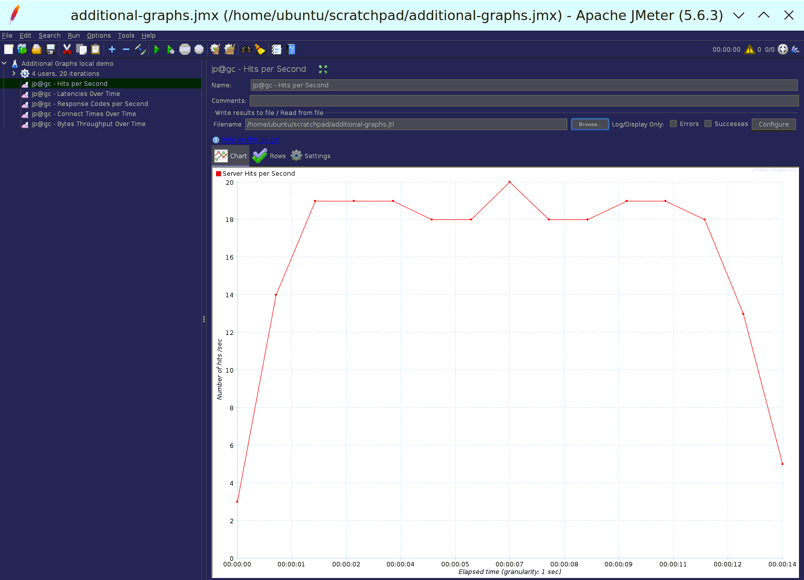
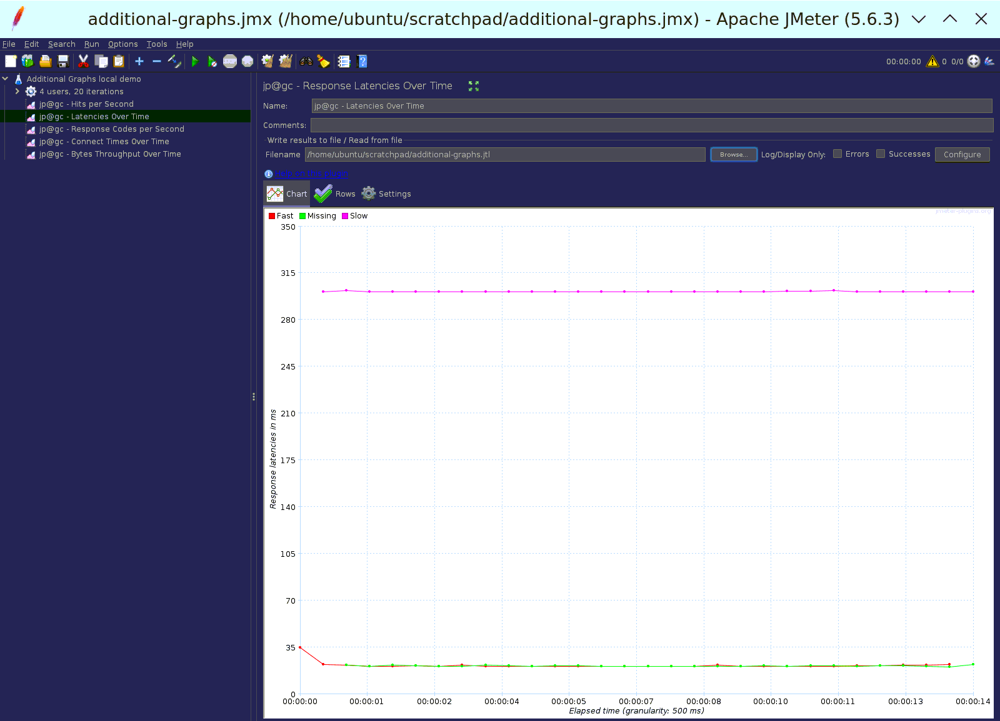
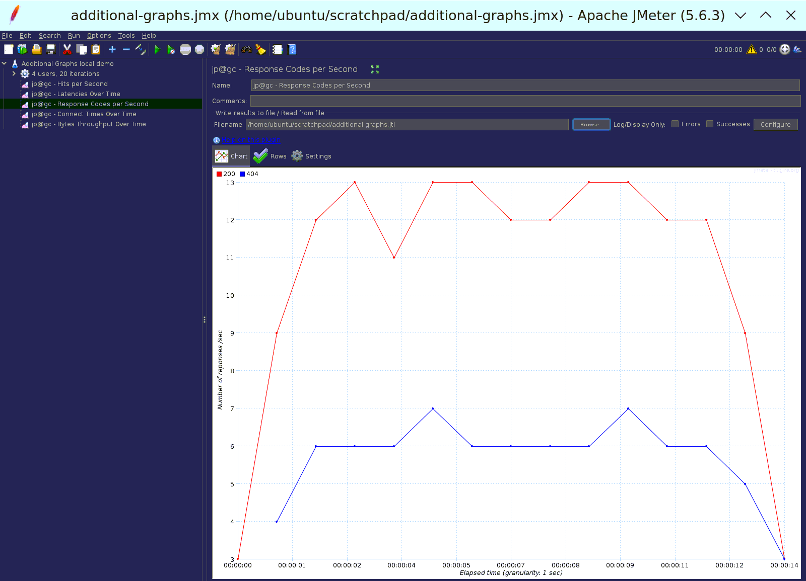
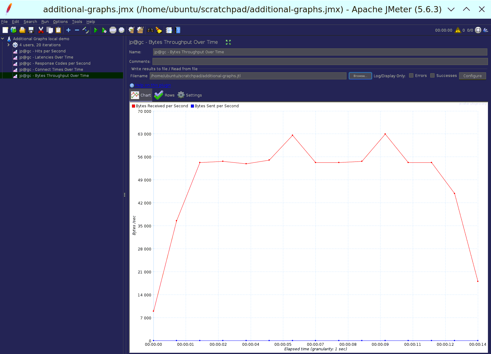

# JMeter Additional Graphs Plugin: Hits per Second, Latency and Response Codes

In this blog post, we will see how the JMeter Additional Graphs plugin helps answer five practical
questions: how many hits reached the server, how long the first response took, how expensive
connections were, how much data moved, and which response codes came back. I will use a small HTTP
test with deliberately slow requests and missing pages, rather than five unrelated example charts.

A response time chart tells me something changed. It does not tell me whether the application
started returning fast errors, whether connections became expensive, or whether the response payload
became smaller. These extra graphs give me different views of the same samples. The useful part is
reading them together, not collecting another five pictures for a report.

## 1. What is the JMeter Additional Graphs plugin?

The jp@gc **5 Additional Graphs** package has plugin ID `jpgc-graphs-additional`. The number five
describes the included listeners; it is not a requirement to use JMeter version 5 specifically. The
[Additional Graphs plugin page](/plugin/jpgc-graphs-additional/) lists the package, and the
PerfAtlas catalog currently records about 10,300 downloads. That makes it a useful companion to the
basic graphs, even though it is easy to overlook in a long listener menu.

| Listener                     | Question I use it to answer                                  |
| :--------------------------- | :----------------------------------------------------------- |
| Hits per Second              | How much request activity did this test generate?            |
| Response Latencies Over Time | How long did samples wait for the beginning of the response? |
| Connect Times Over Time      | How long did establishing connections take?                  |
| Bytes Throughput Over Time   | How much data did JMeter send and receive?                   |
| Response Codes per Second    | Which response codes made up the traffic?                    |

These listeners visualize results. They do not pace requests, create virtual users, or change HTTP
timeout values. If you need response time, active users, and transactions per second, start with my
[3 Basic Graphs guide](/blog/jmeter-basic-graphs-plugin-response-times-active-threads-tps/). This
article focuses on the diagnostic questions that remain after that first view.

## 2. Install the package and preserve the right results

In JMeter, open **Options > Plugins Manager**, select **Available Plugins**, find **5 Additional
Graphs**, and apply the installation. Restart JMeter when prompted. With Plugins Manager's command
line installer already available, the equivalent package installation is:

```bash
"$JMETER_HOME/bin/PluginsManagerCMD.sh" install jpgc-graphs-additional
```

I tested with Apache JMeter 5.6.3 and Additional Graphs 2.0. The listeners appear under **Add >
Listener**, with the `jp@gc` prefix. For example, the latency listener uses
`kg.apc.jmeter.vizualizers.LatenciesOverTimeGui`; the unusual spelling `vizualizers` is intentional.
Normally you never need to type that class name: add the listener through JMeter's menu.

Run meaningful load in non-GUI mode and open results afterward. A CSV JTL needs the measurements you
want to graph. I make these save settings explicit when preparing a reusable diagnostic run:

```properties
jmeter.save.saveservice.output_format=csv
jmeter.save.saveservice.print_field_names=true
jmeter.save.saveservice.timestamp_format=ms
jmeter.save.saveservice.time=true
jmeter.save.saveservice.label=true
jmeter.save.saveservice.response_code=true
jmeter.save.saveservice.successful=true
jmeter.save.saveservice.latency=true
jmeter.save.saveservice.connect_time=true
jmeter.save.saveservice.bytes=true
jmeter.save.saveservice.sent_bytes=true
```

Save those lines in `graph-results.properties` and pass the file with `-q`. Keep the header row.
Saving only elapsed time and a sampler label is not enough to reconstruct response codes or bytes
later. A graph cannot recover a measurement that was never written.

## 3. Build a small, reproducible HTTP test

My local target listened on `127.0.0.1:8091`. It returned 256-byte bodies after a 20 ms delay on
`/fast` and `/missing`, and an 8,192-byte body after a 300 ms delay on `/slow`. The missing path
returned HTTP `404`; the other two returned `200`. This is a controlled example, not a benchmark of
an application server.

You can reproduce that target with Python's standard library. Save this as `target.py`, then run
`python3 target.py` in a separate terminal:

```python
from http.server import BaseHTTPRequestHandler, ThreadingHTTPServer
import time


class Handler(BaseHTTPRequestHandler):
    def do_GET(self):
        time.sleep(0.3 if self.path == "/slow" else 0.02)
        body = b"x" * (8192 if self.path == "/slow" else 256)
        self.send_response(404 if self.path == "/missing" else 200)
        self.send_header("Content-Length", str(len(body)))
        self.end_headers()
        self.wfile.write(body)

    def log_message(self, *args):
        pass


ThreadingHTTPServer(("127.0.0.1", 8091), Handler).serve_forever()
```

In a new JMeter plan, add one ordinary Thread Group with **4 threads**, **2 seconds ramp-up**, and
**20 loops**. Add three HTTP Request samplers in order: `Fast`, `Slow`, and `Missing`, using the
paths above, protocol `http`, server `127.0.0.1`, and port `8091`. Use `GET` and disable **Use
KeepAlive** for this example. Add a **Constant Timer** of **100 ms** under the Thread Group; it
applies before each sampler, not once per loop. Leave the sampler error action as **Continue**.

Save the plan as `additional-graphs.jmx`, then run:

```bash
"$JMETER_HOME/bin/jmeter" -n -t additional-graphs.jmx \
  -q graph-results.properties -l additional-graphs.jtl
```

Use a fresh results filename for each run. My non-GUI run produced **240 samples** in **14.232
seconds**, approximately **16.7 samples/second**. There were 80 samples per endpoint: **160 HTTP
200s** and **80 HTTP 404s**. JMeter reported **33.33% errors**, as expected for the deliberately
missing path. Those errors are part of the example, not a failed installation.

For inspection, add the graph listeners to a separate analysis plan. In each listener, use
**Browse** in the results filename area to open the saved JTL. Do not start the analysis plan
against that existing file. Keep both **Errors** and **Successes** unchecked when you want all
results. The screenshots below were captured from JMeter on the VM using this local workload.

## 4. Read JMeter hits per second without confusing hits with transactions

The [official Hits per Second documentation](https://jmeter-plugins.org/wiki/HitsPerSecond/) states
that hits include child samples from transactions and embedded resource hits. That matters: one
business action is not necessarily one server hit.

In my simple test there are no transaction parents and no embedded resource downloads, so all 240
samples are individual HTTP requests. The run-wide 16.7 samples/second is therefore a useful sanity
check against the hits graph. Individual buckets will differ because of ramp-up, request completion
timing, and the final partial interval. I would not expect every point to equal 16.7.



Now imagine a different plan: one page request downloads nine embedded resources. Ten hits can
belong to one page visit. A business requirement of 50 completed checkouts per second is not met
merely because this chart shows 50 hits per second. Name the unit in your report and document
whether resource retrieval, redirects, and transaction controllers are present.

I use this graph to check delivered activity, not to claim that all activity succeeded. A fast `404`
still produces a hit. That is why I always put response codes next to it.

## 5. Separate latency from elapsed time and connect time

The [plugin latency page](https://jmeter-plugins.org/wiki/LatenciesOverTime/) describes the wait for
the beginning of the server response. For precise JMeter measurement boundaries, use the
[Apache JMeter glossary](https://jmeter.apache.org/usermanual/glossary.html): latency starts just
before sending the request and ends when the first response is received. It is not simply network
round-trip time, and it is not a direct measurement of server execution time.

Here are means calculated from my saved JTL, rounded to one decimal place:

| Sampler | Samples | Elapsed time, ms | Latency, ms | Connect time, ms |
| :------ | ------: | ---------------: | ----------: | ---------------: |
| Fast    |      80 |             21.4 |        21.3 |              0.4 |
| Slow    |      80 |            301.3 |       301.3 |              0.3 |
| Missing |      80 |             21.2 |        21.2 |              0.3 |



The slow endpoint waits before sending headers, so its latency closely tracks its elapsed time. That
is what I intended. A large response streamed slowly after prompt headers would produce a different
pattern: relatively low latency but a much longer elapsed time. A time-bucket average also does not
tell you the 95th or 99th percentile; use an appropriate percentile report for that.

The [Connect Times Over Time documentation](https://jmeter-plugins.org/wiki/ConnectTimeOverTime/)
defines its graph as average time to establish a connection. JMeter includes the SSL handshake in
connect time, and does not automatically subtract connect time from latency. Do not add the two
values together and present the result as total response time.

My loopback HTTP connections were cheap, even with keep-alive disabled. That is not evidence that
TLS negotiation or a remote network will be cheap. In a real test, investigate a connect-time rise
alongside connection reuse, connection failures, and infrastructure telemetry. With reuse enabled,
many samples need no new connection at all; a low average alone cannot prove that every new
connection was fast.

## 6. Check response codes before celebrating throughput

The [Response Codes per Second listener](https://jmeter-plugins.org/wiki/ResponseCodesPerSecond/)
plots returned response codes over time. My two series are `200` and `404`, matching the 160/80
split in the JTL. The chart makes an important distinction visible: a third of my request activity
was intentionally unsuccessful.



Suppose a service replaces expensive successful responses with quick `503` responses. Overall
throughput might increase and average elapsed time might fall. Without the code split, that can look
like a performance improvement. With the code split, it is a reason to investigate availability.

Response codes are not the same thing as JMeter success flags. An assertion can fail on a `200`
response because a required field is absent. Conversely, a test may deliberately validate an
expected error response. Use assertions to express correctness, and review the error rate as well as
the code graph. This listener is not a substitute for functional validation of response bodies.

For troubleshooting, I first ask whether the code mix changed at the same time as the hits curve.
Then I compare affected sampler labels and server logs. A response-code chart alone cannot tell me
which dependency caused an HTTP `500`.

## 7. Use bytes throughput to catch payload changes

The [Bytes Throughput documentation](https://jmeter-plugins.org/wiki/BytesThroughput/) describes
bytes sent and received by JMeter. It is a data-rate view, not another request-rate view.

In this run, the average recorded received bytes per sample were **370** for Fast, **8,307** for
Slow, and **377** for Missing. These exceed the response bodies because the HTTP measurements also
account for response headers. Do not compare the graph directly to the Python body sizes and
conclude that JMeter counted incorrectly.



At the same request rate, switching from an 8 KB response to a 256-byte error body can sharply
reduce received throughput. That drop is not automatically a network bottleneck. Check response
codes and payload expectations first. Compression, changing response content, and different endpoint
mixes can also change recorded byte rates without a change in user concurrency.

I use network-interface monitoring when I need actual link utilization. Application-level sample
bytes and interface-level traffic have different boundaries; they should not be treated as
interchangeable measurements.

## 8. A practical review order and common pitfalls

My review order is straightforward: check hits, check response codes, compare latency with elapsed
time, inspect connection behavior, then look at bytes. This prevents a quick error response from
being mistaken for an optimization.

Before sharing the graphs, I check three things:

1. **Same time window.** Comparing a full-run hits graph with latency from only the steady state is
   misleading. For a separate steady-state analysis, see my
   [Filter Results Tool guide](/blog/jmeter-filter-results-tool-remove-ramp-up-filter-jtl-results/).
2. **Same granularity.** A short spike visible in one-second buckets can disappear in a one-minute
   average. Review the listener's Settings tab and state the grouping interval in your report.
3. **Enough input data.** If a graph is empty, confirm the JTL has samples and the required column,
   check the Errors/Successes filters, and verify the package is installed in the JMeter instance
   you actually launched. Missing latency values cannot be fixed by changing chart colors.

Keep GUI listeners out of your main load-generating workflow when they are not needed. The JTL is
the reusable artifact; screenshots are views of it. Preserve the test plan, save properties, JMeter
version, and plugin version alongside results so another engineer can reproduce the analysis.

## 9. Conclusion

The JMeter Additional Graphs plugin is most useful when I read its metrics as a set. Hits tell me
how much activity happened; codes tell me what came back; latency and connection time narrow the
timing question; bytes expose changes in the data being transferred.

The takeaway from this run is deliberately simple: **16.7 samples per second was not 16.7 successful
requests per second**. Eighty of the 240 responses were `404`s. Check that distinction before you
call a faster graph a better result.
