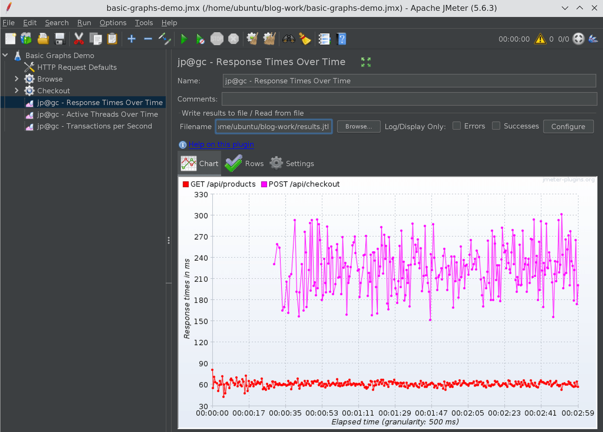
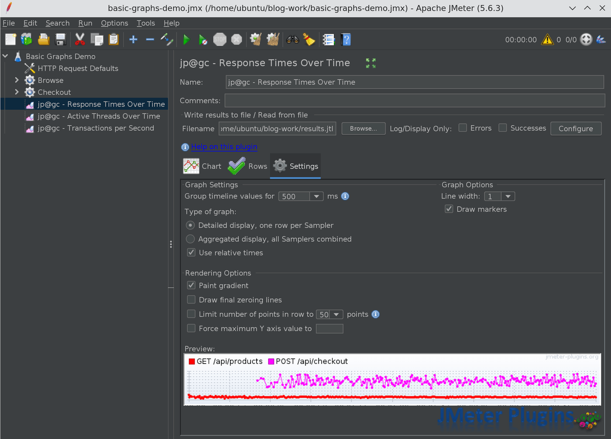
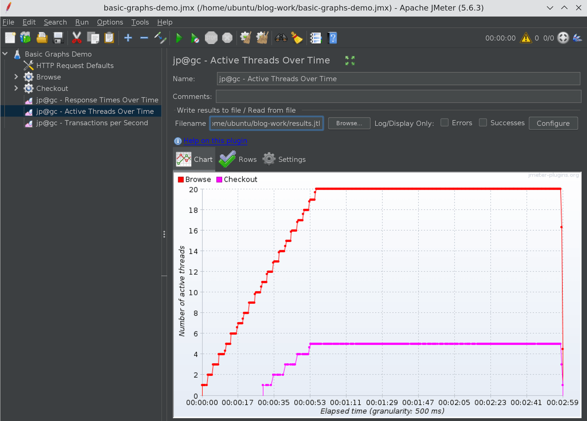
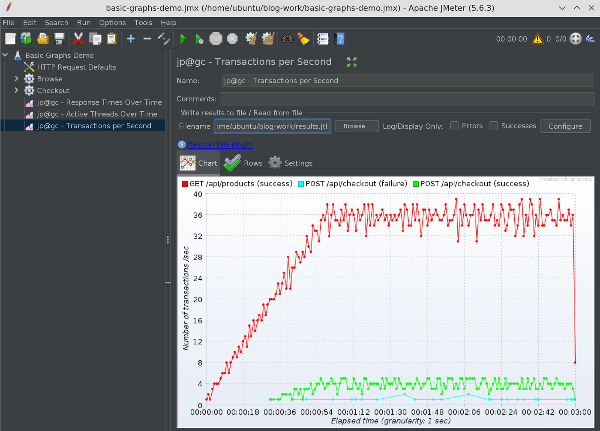
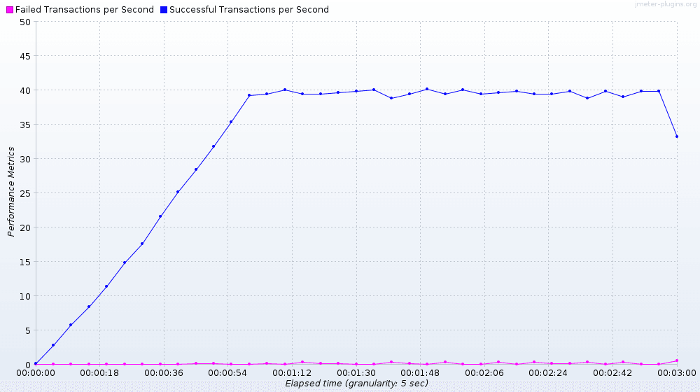
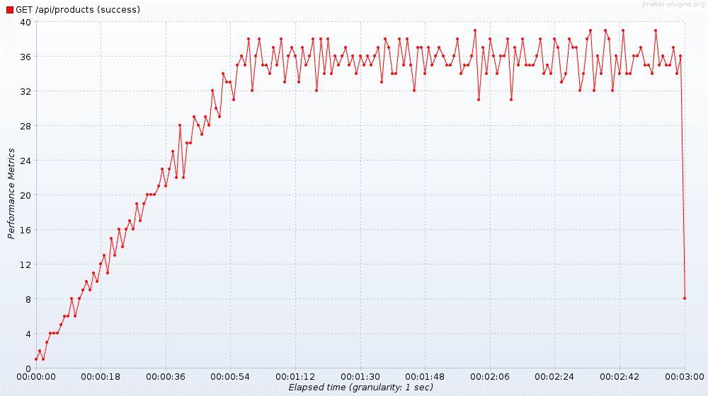

# JMeter 3 Basic Graphs Plugin: Response Times, Active Threads and TPS Over Time

In this blog post, we will see how to use the JMeter 3 Basic Graphs plugin to plot Response Times
Over Time, Active Threads Over Time, and Transactions per Second, and how to turn the same graphs
into PNG files from the command line with JMeterPluginsCMD, so you never have to open the GUI after
a CI run.

The 3 Basic Graphs plugin (id `jpgc-graphs-basic`) is one of the oldest members of the jp@gc set on
jmeter-plugins.org, and it is still one of the most installed. On the
[PerfAtlas plugin page](/plugin/jpgc-graphs-basic/) it shows around 21,000 downloads in the latest
weekly snapshot. That makes it the second most downloaded third-party plugin in the directory, right
after Custom Thread Groups. The companion command-line tool,
[Command-Line Graph Plotting Tool](/plugin/jpgc-cmd/) (`jpgc-cmd`), sits at around 5,600.

Everything in this post comes from a real run I did for this article: JMeter 5.6.3, Java 17,
`jmeter-plugins-graphs-basic-2.0`, `jmeter-plugins-cmd-2.3`, and a small local mock API. All
screenshots and numbers are from that run.

## 1. What is inside the 3 Basic Graphs plugin?

The plugin ships three listeners. Each one plots a single metric against elapsed time, which is
exactly what the built-in Summary and Aggregate Reports do not give you.

| Listener (GUI name)              | GUI class                                            | What it plots                                  |
| :------------------------------- | :--------------------------------------------------- | :--------------------------------------------- |
| jp@gc - Response Times Over Time | `kg.apc.jmeter.vizualizers.ResponseTimesOverTimeGui` | Average response time (ms) per sampler         |
| jp@gc - Active Threads Over Time | `kg.apc.jmeter.vizualizers.ThreadsStateOverTimeGui`  | Active threads per thread group                |
| jp@gc - Transactions per Second  | `kg.apc.jmeter.vizualizers.TransactionsPerSecondGui` | Finished transactions per second, pass or fail |

A few details from the official docs are worth knowing up front:

- [Response Times Over Time](https://jmeter-plugins.org/wiki/ResponseTimesOverTime/) shows the
  average response time in milliseconds for each sampler.
- [Active Threads Over Time](https://jmeter-plugins.org/wiki/ActiveThreadsOverTime/) shows one line
  per thread group. For distributed tests, the docs recommend naming thread groups like
  `${__machineName()}_My Threadgroup name` so each load generator gets its own line.
- [Transactions per Second](https://jmeter-plugins.org/wiki/TransactionsPerSecond/) counts finished
  transactions per second for each sampler and shows failed transactions as a separate series. The
  aggregated display replaces the old "Total Transactions per Second" graph.

If you need hits per second, latency, connect time, or response codes, those live in the separate
[5 Additional Graphs](/plugin/jpgc-graphs-additional/) plugin.

## 2. Install the plugin and the CMD tool

The easiest way is through the Plugins Manager. If you do not have it yet, follow
[How to install JMeter Plugins Manager](/blog/how-to-install-jmeter-plugins-manger/) first. In the
GUI, go to **Options > Plugins Manager > Available Plugins**, tick **3 Basic Graphs** and
**Command-Line Graph Plotting Tool**, and restart JMeter.

For build agents and containers, I prefer the CLI:

```bash
cd $JMETER_HOME
bin/PluginsManagerCMD.sh install jpgc-graphs-basic,jpgc-cmd
```

After the install, `lib/ext` had these jars on my machine:

```text
jmeter-plugins-cmd-2.3.jar
jmeter-plugins-cmn-jmeter-0.8.jar
jmeter-plugins-graphs-basic-2.0.jar
jmeter-plugins-manager-2.0.jar
```

And `bin/` gets the `JMeterPluginsCMD.sh` and `JMeterPluginsCMD.bat` launchers. If you are baking
this into a Docker image, the same command works inside a `RUN` step, as I showed in
[JMeter Plugin Install Automation with PluginsManagerCMD in a Docker Image](/blog/jmeter-plugin-install-automation-pluginsmanagercmd-docker/).

One gotcha I hit: Maven Central returned HTTP 429 (rate limited) while PluginsManagerCMD was
downloading the jars. Rerunning later, or pre-downloading the jars from a mirror into `lib/ext`,
fixed it. If your CI agents share an egress IP, expect to see this occasionally.

## 3. The demo test plan

To get graphs that actually tell a story, I used a mock API on `127.0.0.1:8080` with two endpoints:

- `GET /api/products` responds in 40 to 80 ms, always 200.
- `POST /api/checkout` responds in 150 to 300 ms, and returns 500 about 5% of the time.

The test plan has two standard thread groups:

| Thread Group | Threads | Ramp-up | Start delay | Duration | Sampler              | Think time             |
| :----------- | ------: | ------: | ----------: | -------: | :------------------- | :--------------------- |
| Browse       |      20 |    60 s |         0 s |    180 s | `GET /api/products`  | Constant Timer 500 ms  |
| Checkout     |       5 |    30 s |        30 s |    150 s | `POST /api/checkout` | Constant Timer 1000 ms |

The three listeners sit at the Test Plan level, so they see samples from both thread groups. In the
JMX, each listener is a `CorrectedResultCollector` with the matching GUI class:

```xml
<kg.apc.jmeter.vizualizers.CorrectedResultCollector
    guiclass="kg.apc.jmeter.vizualizers.ResponseTimesOverTimeGui"
    testclass="kg.apc.jmeter.vizualizers.CorrectedResultCollector"
    testname="jp@gc - Response Times Over Time" enabled="true">
  <boolProp name="ResultCollector.error_logging">false</boolProp>
  <!-- saveConfig omitted -->
  <stringProp name="filename"></stringProp>
</kg.apc.jmeter.vizualizers.CorrectedResultCollector>
```

Before looking at graphs, it helps to predict what they should show. A Browse thread spends about 60
ms waiting for the response and 500 ms in the timer, so one thread does roughly 1 / 0.56 = 1.8
requests per second. With 20 threads, that is about 35.7 TPS for products. Checkout threads do 1 /
(0.225 + 1.0) = 0.8 TPS each, so 5 threads give about 4 TPS. Keep those numbers in mind.

## 4. Run the test in non-GUI mode

Like any real load test, I ran it in non-GUI mode and wrote the raw results to a JTL file:

```bash
jmeter -n -t basic-graphs-demo.jmx -l results.jtl -e -o report
```

The run finished with 5,954 samples and 25 errors (0.42%):

| Label                | Samples | Errors | Error % |
| :------------------- | ------: | -----: | ------: |
| `GET /api/products`  |   5,392 |      0 |   0.00% |
| `POST /api/checkout` |     562 |     25 |   4.45% |

The Active Threads Over Time graph needs the thread counts in the JTL. In JMeter 5.6.3,
`jmeter.save.saveservice.thread_counts` is commented out in `bin/jmeter.properties`, and the default
is `true`, so the CSV JTL already contains the `grpThreads` and `allThreads` columns:

```text
timeStamp,elapsed,label,responseCode,responseMessage,threadName,dataType,success,failureMessage,bytes,sentBytes,grpThreads,allThreads,URL,Latency,IdleTime,Connect
```

If someone in your team has turned it off in `user.properties`, put it back, otherwise the graph
will be flat:

```properties
jmeter.save.saveservice.thread_counts=true
```

## 5. Response Times Over Time

Open the JMX in the GUI, select **jp@gc - Response Times Over Time**, type the path of `results.jtl`
into the **Filename** field and press Enter (or use **Browse...**). The listener reads the file and
draws the graph.



What I read from this graph:

- `GET /api/products` sits flat around 60 ms for the whole run, including the ramp-up. Adding 20
  threads did not move it, which is what you want to see.
- `POST /api/checkout` starts at 00:00:30, which matches the 30 s start delay, and bounces between
  150 and 300 ms. That is the random sleep in the mock, not a degradation trend.

This is the main reason to use this graph over the Aggregate Report: a 90th percentile of 280 ms
looks the same whether the latency was stable or slowly climbing. The time axis tells you which one
it was.

The **Settings** tab controls how the graph is drawn:



The options I use most often:

- **Group timeline values for**: the granulation, 500 ms by default. For a one-hour test, 500 ms
  gives you 7,200 points per line, which is noisy. 5,000 or 10,000 ms is easier to read.
- **Type of graph**: detailed display (one row per sampler) or aggregated display (all samplers
  combined into one line).
- **Use relative times**: elapsed time from test start on the X axis, instead of wall-clock time.
- **Limit number of points in row** and **Force maximum Y axis value**: useful when one outlier
  squashes the rest of the graph.

## 6. Active Threads Over Time

Do the same for **jp@gc - Active Threads Over Time**:



Browse climbs one thread every 3 seconds up to 20 at about 00:00:55, and Checkout starts at 00:00:30
and reaches 5 threads 30 seconds later. Both drop to zero at 00:03:00.

This graph is the quickest sanity check that your load model is what you think it is. I use it every
time I switch between thread group types, because the shape is very different for each. If you are
deciding between the Ultimate Thread Group and the Arrivals Thread Group, this is the graph I used
to compare them in
[JMeter Ultimate Thread Group vs Arrivals Thread Group](/blog/jmeter-ultimate-thread-group-vs-arrivals-thread-group/).

## 7. Transactions per Second

And finally **jp@gc - Transactions per Second**:



The numbers match the prediction from section 3:

- `GET /api/products (success)` ramps with the threads and plateaus between 32 and 39 TPS. I
  predicted about 35.7.
- `POST /api/checkout (success)` hovers around 3 to 5 TPS. I predicted about 4.
- `POST /api/checkout (failure)` is a separate series at 1 or 2 per second, only in the seconds
  where a 500 happened.

Notice how the plugin labels each line with `(success)` or `(failure)`. A sampler that never fails,
like `GET /api/products`, has no failure line at all. Also note the failure line connects points
across seconds with no failures, so do not read the line between two points as a sustained error
rate.

When TPS is flat while the active threads keep growing, you have found your saturation point. When
TPS drops while threads are flat, response times went up. Putting these two graphs side by side
answers most "is the system keeping up" questions.

## 8. Generate the graphs from the CLI with JMeterPluginsCMD

Opening the GUI after every run does not scale, and it does not work on a CI agent at all. This is
where [JMeterPluginsCMD](https://jmeter-plugins.org/wiki/JMeterPluginsCMD/) comes in. It renders the
same graphs straight from the JTL file to PNG or CSV. The `--plugin-type` values for the three basic
graphs are:

| Graph                    | `--plugin-type`         |
| :----------------------- | :---------------------- |
| Response Times Over Time | `ResponseTimesOverTime` |
| Active Threads Over Time | `ThreadsStateOverTime`  |
| Transactions per Second  | `TransactionsPerSecond` |

Note that Active Threads Over Time is `ThreadsStateOverTime`, not `ActiveThreadsOverTime`. That is
the name of the underlying class.

These are the exact commands I ran:

```bash
CMD=$JMETER_HOME/bin/JMeterPluginsCMD.sh

$CMD --generate-png response-times-over-time.png --input-jtl results.jtl \
  --plugin-type ResponseTimesOverTime --width 1000 --height 560

$CMD --generate-png active-threads-over-time.png --input-jtl results.jtl \
  --plugin-type ThreadsStateOverTime --width 1000 --height 560

$CMD --generate-png transactions-per-second.png --input-jtl results.jtl \
  --plugin-type TransactionsPerSecond --width 1000 --height 560
```

Each command takes about a second and a half on a 6,000-sample JTL. You can also export the graph
data as CSV, which is handy if you want to plot it somewhere else or diff two runs:

```bash
$CMD --generate-csv rtot.csv --input-jtl results.jtl --plugin-type ResponseTimesOverTime
```

```text
Elapsed time,GET /api/products,POST /api/checkout
11:31:24.500,81.0,
11:31:25.0,55.0,
11:31:25.500,71.0,
```

The optional parameters mirror the GUI settings. For a cleaner CI artifact, I combine a 5-second
granulation with aggregated rows:

```bash
$CMD --generate-png tps-5s-aggregate.png --input-jtl results.jtl \
  --plugin-type TransactionsPerSecond --width 1000 --height 560 \
  --granulation 5000 --aggregate-rows yes
```



With aggregation, the plugin collapses everything into two lines, "Successful Transactions per
Second" and "Failed Transactions per Second". The total plateau is around 39 to 40 TPS, which is
35.7 + 4 from our earlier estimate.

To focus on one transaction, filter by label:

```bash
$CMD --generate-png tps-products-only.png --input-jtl results.jtl \
  --plugin-type TransactionsPerSecond --width 1000 --height 560 \
  --exclude-labels 'POST /api/checkout'
```



The parameters I find most useful:

| Parameter                               | What it does                                        |
| :-------------------------------------- | :-------------------------------------------------- |
| `--granulation <ms>`                    | Bucket size, same as "Group timeline values for"    |
| `--aggregate-rows yes`                  | Combine all samplers into one row                   |
| `--relative-times no`                   | Wall-clock times on the X axis                      |
| `--include-labels` / `--exclude-labels` | Comma-separated list of labels to keep or drop      |
| `--success-filter true`                 | Only successful samples (`false` for only failures) |
| `--start-offset` / `--end-offset`       | Trim warm-up or ramp-down seconds                   |
| `--force-y <limit>`                     | Fix the Y axis so runs are comparable               |

Two things I noticed while running these. First, every run prints a couple of
`JMeterUtils.appProperties is null` warnings and `Using JMeterPluginsCMD v. N/A`. They are harmless;
the PNG is still written. Second, `--help` lists some tool classes (`PerfMonAgent`, `TestPlanCheck`,
`FilterResults`) as missing. Those belong to other plugins and only matter if you want to use those
tools.

## 9. Putting it into a pipeline

A minimal post-test step in any CI system looks like this:

```bash
jmeter -n -t plan.jmx -l results.jtl

for g in ResponseTimesOverTime ThreadsStateOverTime TransactionsPerSecond; do
  $JMETER_HOME/bin/JMeterPluginsCMD.sh --generate-png "graphs/${g}.png" \
    --input-jtl results.jtl --plugin-type "$g" \
    --width 1200 --height 600 --granulation 5000
done
```

Then publish the `graphs/` folder as a build artifact. Use `--force-y` with the same value across
runs if you want to compare screenshots from different builds by eye. If you also want the build to
fail on an SLA breach, pair this with the
[JMeter AutoStop Listener](/blog/jmeter-autostop-listener-stop-tests-on-sla-breach/).

If you would rather have the graphs generated at the end of the test without a separate step, the
[Graphs Generator Listener](/plugin/jpgc-ggl/) does a bulk export from inside the test plan. I still
prefer the CMD tool because it runs on any existing JTL, including old ones.

A few practical tips:

- Keep the three listeners in the JMX for local debugging, but leave their Filename empty and rely
  on `-l results.jtl` for real runs. One JTL feeds every graph.
- For long tests, start with 5,000 or 10,000 ms granulation. 500 ms is fine for a 3 minute run, not
  for a soak test.
- Use `--start-offset` to drop the ramp-up when you want to talk only about steady-state numbers.

## Conclusion

The JMeter 3 Basic Graphs plugin gives you the three time-series views every load test report needs:
response time, active threads, and transactions per second. In my run, the graphs confirmed the load
model within a few TPS of the back-of-the-envelope estimate, and showed that checkout latency was
noisy but not trending up.

The takeaway: use the listeners in the GUI to explore a JTL, and use JMeterPluginsCMD with
`ResponseTimesOverTime`, `ThreadsStateOverTime`, and `TransactionsPerSecond` to generate the same
graphs as PNGs in CI. Same data, no GUI, and a picture attached to every build.
