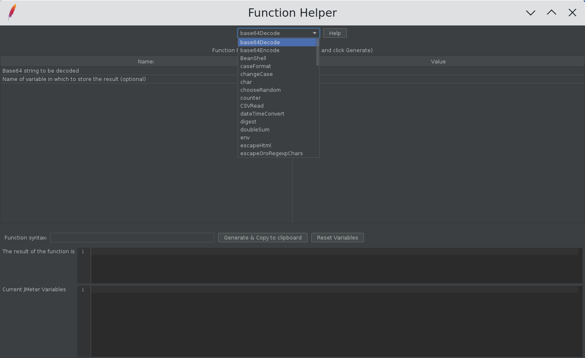
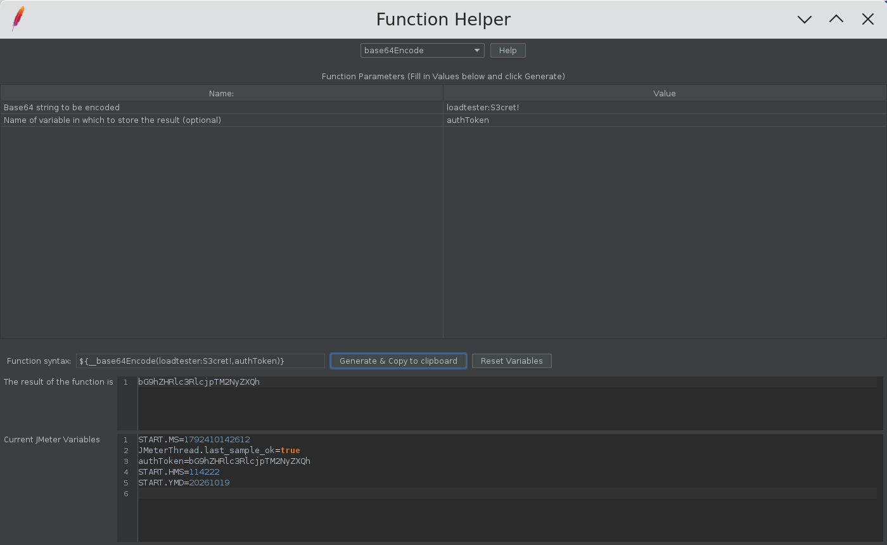
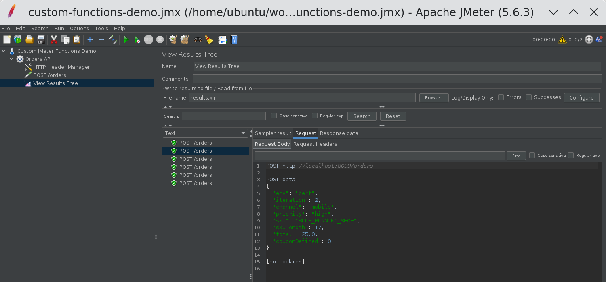
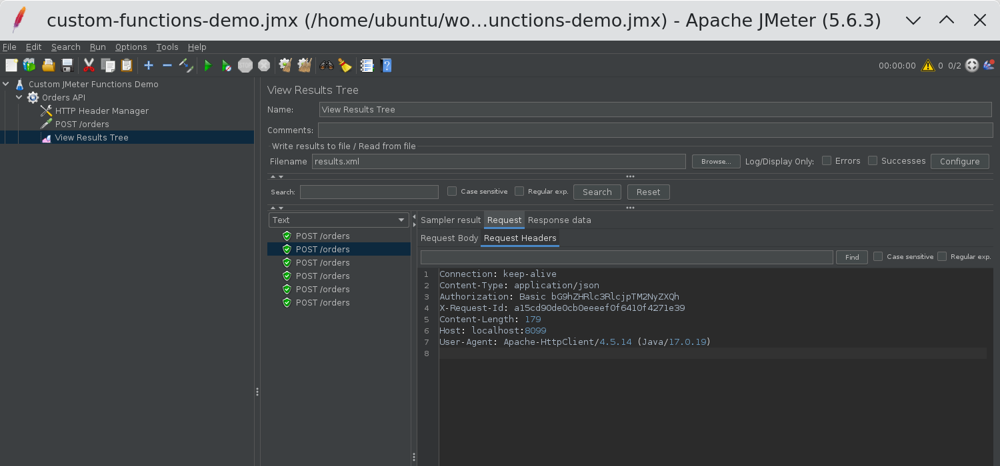

# JMeter Custom Functions Plugin: How to Use `__env`, `__base64Encode`, `__MD5` and More

In this blog post, we will see how to use the JMeter Custom Functions plugin to read environment
variables, build Basic auth headers, generate request IDs, pick random values, and format test data
without writing a single line of Groovy. I will walk through a small test plan that uses nine of the
plugin's functions in one request, show the actual request JMeter sent, and cover the pitfalls I hit
while building it.

The Custom JMeter Functions plugin (plugin id `jpgc-functions`) is one of the most installed jp@gc
plugins. On the [PerfAtlas plugin page](/plugin/jpgc-functions/) it shows 12,634 downloads in the
latest weekly snapshot, which makes it the 6th most downloaded third-party plugin in the directory,
ahead of both Additional Graphs and the Flexible File Writer. It also gained 1,668 downloads week
over week. Most people install it because a script from a colleague used `__env` or
`__base64Encode`, and then never look at the rest of the functions. Let us fix that.

Everything below was run on Apache JMeter 5.6.3 with Java 17 and Custom JMeter Functions 2.2 against
a small local echo API, and the screenshots are from that run.

## 1. What is the JMeter Custom Functions plugin?

JMeter functions are the `${__name(arg1,arg2,...)}` expressions you can put in almost any field of a
test plan: a URL path, a header value, a request body, or a CSV file name. JMeter ships with a good
set of built-in functions such as `__time`, `__Random`, `__counter`, and `__P`. The
[official Custom Functions wiki](https://jmeter-plugins.org/wiki/Functions/) adds the following:

| Function                            | What it does                                                     |
| :---------------------------------- | :--------------------------------------------------------------- |
| `__env`                             | Reads an OS environment variable, with an optional default       |
| `__base64Encode`, `__base64Decode`  | Encodes or decodes a string in Base64                            |
| `__MD5`                             | Returns the MD5 hash of a string as 32 lowercase hex characters  |
| `__chooseRandom`                    | Picks one value from a list and stores it in a variable          |
| `__if`                              | Returns one of two values based on a string equality check       |
| `__doubleSum`                       | Adds two or more floating point numbers                          |
| `__isDefined`                       | Returns `1` if a JMeter variable exists, otherwise `0`           |
| `__iterationNum`                    | Returns the current iteration number of the thread               |
| `__strLen`, `__substring`           | Length of a string, and Java `substring(begin, end)`             |
| `__strReplace`, `__strReplaceRegex` | Java `String.replace` and `String.replaceAll`                    |
| `__uppercase`, `__lowercase`        | Changes the case of a string                                     |
| `__caseFormat`                      | Converts text to camel, snake, kebab, train, or upper underscore |

Almost every function accepts an optional last argument: the name of a JMeter variable where the
result is also stored. That one detail is what makes these functions useful in a chain, and we will
use it heavily in section 4.

## 2. Installing Custom JMeter Functions

The easiest way is the JMeter Plugins Manager: Options, Plugins Manager, Available Plugins, search
for "Custom JMeter Functions", and apply the changes. For CI images, install it from the command
line with the plugin id:

```bash
./bin/PluginsManagerCMD.sh install jpgc-functions
./bin/PluginsManagerCMD.sh status
```

The status output on my machine:

```text
[jpgc-functions=2.2, jpgc-plugins-manager=1.10, jmeter-core=5.6.3, jmeter-http=5.6.3, ...]
```

If you bake plugins into a container, I covered the full flow in
[JMeter plugin install automation with PluginsManagerCMD in Docker](/blog/jmeter-plugin-install-automation-pluginsmanagercmd-docker/).
For an offline install, the plugin is two JARs from Maven Central:
`jmeter-plugins-functions-2.2.jar` goes into `lib/ext`, and its dependency
`jmeter-plugins-cmn-jmeter-0.7.jar` goes into `lib`.

After a restart, open Tools, Function Helper Dialog. The new functions appear in the dropdown next
to the built-in ones, sorted alphabetically.



## 3. Use the Function Helper to get the syntax right

I always build a new function call in the Function Helper first. Pick the function, fill in the
parameters, and click Generate. The helper shows the exact syntax, the result, and the JMeter
variables after the call. Here I encoded the demo credentials `loadtester:S3cret!` and stored the
result in `authToken`:



The "Current JMeter Variables" panel is the quickest way to confirm that the optional variable name
argument works the way you expect, before you put the function in a 500-thread test.

## 4. A practical example: one request, nine custom functions

The demo test plan has a Thread Group with 2 threads, a 1 second ramp-up, and 3 loops, so 6 samples
in total. It sends `POST /orders` to a local echo server on port 8099 that returns the headers and
body it received.

The HTTP Header Manager builds a Basic auth header from two environment variables and a request ID
from the thread number, iteration, and time:

```text
Authorization  Basic ${__base64Encode(${__env(API_USER,,perfuser)}:${__env(API_PASS,,changeme)})}
X-Request-Id   ${__MD5(${__threadNum}-${__iterationNum}-${__time()})}
Content-Type   application/json
```

The `__env` arguments are the environment variable name, an optional JMeter variable name (left
empty here), and a default value. So the credentials never live in the JMX, and the test still runs
on a laptop with `perfuser:changeme` when the variables are not set.

The request body uses the rest of the functions:

```json
{
  "env": "${__env(TARGET_ENV,targetEnv,staging)}",
  "iteration": ${__iterationNum},
  "channel": "${__chooseRandom(web,mobile,partner-api,channel)}",
  "priority": "${__if(${channel},mobile,high,normal)}",
  "sku": "${__caseFormat(Blue Running Shoe,UPPER_UNDERSCORE,sku)}",
  "skuLength": ${__strLen(${sku})},
  "total": ${__doubleSum(19.99,5.01,orderTotal)},
  "couponDefined": ${__isDefined(coupon)}
}
```

Notice how values flow from one function to the next inside the same field. `__chooseRandom` stores
its pick in `channel`, and `__if` reads `${channel}` two lines later. `__caseFormat` stores `sku`,
and `__strLen` measures it. JMeter evaluates the expressions from left to right, so this works as
long as the producer appears before the consumer.

Here is how it looks inside the JMX, in case you want to paste it into your own plan:

```xml
<elementProp name="" elementType="Header">
  <stringProp name="Header.name">X-Request-Id</stringProp>
  <stringProp name="Header.value">${__MD5(${__threadNum}-${__iterationNum}-${__time()})}</stringProp>
</elementProp>
```

I ran it in non-GUI mode with the environment variables set:

```bash
export API_USER=loadtester API_PASS='S3cret!' TARGET_ENV=perf
./bin/jmeter -n -t custom-functions-demo.jmx -l results.jtl
```

```text
summary =      6 in 00:00:01 =   11.5/s Avg:     3 Min:     1 Max:    18 Err:     0 (0.00%)
```

## 5. What JMeter actually sent

The View Results Tree shows the resolved values. For the second iteration of thread 1, the request
body was:



And the request headers:



Let me map each value back to its function:

| Field / header  | Expression                                   | Resolved value                     |
| :-------------- | :------------------------------------------- | :--------------------------------- |
| `env`           | `__env(TARGET_ENV,targetEnv,staging)`        | `perf` (from the OS)               |
| `iteration`     | `__iterationNum`                             | `2`                                |
| `channel`       | `__chooseRandom(web,mobile,partner-api,...)` | `mobile`                           |
| `priority`      | `__if(${channel},mobile,high,normal)`        | `high`                             |
| `sku`           | `__caseFormat(...,UPPER_UNDERSCORE,sku)`     | `BLUE_RUNNING_SHOE`                |
| `skuLength`     | `__strLen(${sku})`                           | `17`                               |
| `total`         | `__doubleSum(19.99,5.01,orderTotal)`         | `25.0`                             |
| `couponDefined` | `__isDefined(coupon)`                        | `0`                                |
| `Authorization` | `__base64Encode(...)`                        | `Basic bG9hZHRlc3RlcjpTM2NyZXQh`   |
| `X-Request-Id`  | `__MD5(...)`                                 | `a15cd90de0cb0eeeef0f6410f4271e39` |

Across the 6 samples, every request had a different `X-Request-Id`, and the `priority` field was
`high` only on the samples where `channel` was `mobile`.

## 6. Function reference with argument order

The argument order is where most mistakes happen, so here is what I verified against the plugin
source for version 2.2. Arguments in square brackets are optional.

| Function            | Arguments                                                  |
| :------------------ | :--------------------------------------------------------- |
| `__env`             | `name`, [`varName`], [`default`]                           |
| `__base64Encode`    | `string`, [`varName`]                                      |
| `__base64Decode`    | `string`, [`varName`]                                      |
| `__MD5`             | `string`, [`varName`]                                      |
| `__chooseRandom`    | `value1`, `value2`, ..., `varName` (at least 3 arguments)  |
| `__if`              | `actual`, `expected`, `ifEqual`, `ifNotEqual`, [`varName`] |
| `__doubleSum`       | `number1`, `number2`, ..., [`varName`]                     |
| `__isDefined`       | `varName`                                                  |
| `__strLen`          | `string`, [`varName`]                                      |
| `__substring`       | `string`, `beginIndex`, `endIndex`, [`varName`]            |
| `__strReplace`      | `string`, `search`, `replacement`, [`varName`]             |
| `__strReplaceRegex` | `string`, `regex`, `replacement`, [`varName`]              |
| `__caseFormat`      | `string`, [`mode`], [`varName`]                            |

For `__caseFormat`, the mode is case insensitive. The supported values include `LOWER_CAMEL_CASE`
(the default when the mode is empty), `UPPER_CAMEL_CASE`, `SNAKE_CASE`, `KEBAB_CASE`, `TRAIN_CASE`,
and `UPPER_UNDERSCORE`. The 2.2 release also fixed a usability issue in `__strReplaceRegex`, so make
sure you are not on an older version if you rely on it.

## 7. Pitfalls I hit while building the demo

**1. `__chooseRandom` always treats the last argument as a variable name.** If you write
`${__chooseRandom(web,mobile,partner-api)}`, the plugin picks between `web` and `mobile` only, and
stores the result in a variable called `partner-api`. Always add a variable name as the last
argument, even if you do not need it.

**2. `__doubleSum` decides if the last argument is a variable name by parsing it.** If the last
argument is a number, it is added to the sum and nothing is stored. If it is not a number, it is
treated as the variable name. `${__doubleSum(1.5,2.5)}` returns `4.0`, while
`${__doubleSum(1.5,2.5,total)}` returns `4.0` and also sets `total`. Also note the output is a Java
`double`, so `25` becomes `25.0`. Make sure your API accepts that format.

**3. `__if` compares strings, not numbers.** The plugin uses a plain `equals` check, so `5` and
`5.0` are different, and so are `Mobile` and `mobile`. Normalize the value first with `__lowercase`
or `__caseFormat` if the source is inconsistent.

**4. `__env` without a default returns the variable name.** If `TARGET_ENV` is not set and you write
`${__env(TARGET_ENV)}`, you get the literal string `TARGET_ENV` in your request, not an empty value.
I always pass a default. Also remember that in distributed mode, functions run on the load
generators, so each remote server needs the environment variable, not only the controller. The
[distributed load testing plugins post](/blog/jmeter-plugins-for-distributed-load-testing/) has more
on that setup.

**5. Commas inside arguments must be escaped.** JMeter splits function arguments on commas. To
encode `a,b` with `__base64Encode`, write `a\,b`. This is standard JMeter function behavior, and the
Function Helper escapes it for you if you type the value there.

**6. `__MD5` is for identifiers, not security.** It is perfect for a unique, fixed-length request ID
or a cache key that a server expects. If the API needs an HMAC or SHA-256 signature, use the
built-in `__digest` function, which supports other algorithms and a salt.

## 8. Custom functions or built-in JMeter functions?

JMeter 4.0 and later added several built-in functions that overlap with this plugin. I still use the
plugin in a few cases, mainly because the syntax is shorter and the optional variable name is
consistent across all functions.

| Task                         | Custom JMeter Functions | Built-in alternative                         |
| :--------------------------- | :---------------------- | :------------------------------------------- |
| Read an environment variable | `__env`                 | `__groovy(System.getenv('NAME'))`            |
| Base64 encode                | `__base64Encode`        | `__groovy` with `java.util.Base64`           |
| MD5 or SHA hash              | `__MD5`                 | `__digest(MD5,...)`, also SHA-256 and others |
| Random pick from a list      | `__chooseRandom`        | `__RandomFromMultipleVars` (needs variables) |
| Case conversion              | `__caseFormat`          | `__changeCase` (upper, lower, capitalize)    |
| Check if a variable exists   | `__isDefined`           | `__isVarDefined`                             |

My rule of thumb: if the function is evaluated on every sample at high throughput, prefer a
non-scripting function over `__groovy`. Both the plugin functions and the built-in ones like
`__digest` are plain Java and avoid the script engine overhead. For quick mock data while you design
the plan, pair these functions with the
[Dummy Sampler](/blog/jmeter-dummy-sampler-mock-api-responses-debug-test-plans/) so you can check
the output without a server.

## Conclusion

The JMeter Custom Functions plugin gives you small, focused functions for the jobs that come up in
almost every API test: reading environment variables, encoding credentials, generating request IDs,
and shaping test data. Use the Function Helper to get the syntax right, always pass a default to
`__env` and a variable name to `__chooseRandom`, and remember that `__if` compares plain strings.
With those three habits, you can keep secrets out of your JMX and Groovy out of your hot path.

You can find download trends, versions, and the install ID on the
[Custom JMeter Functions page](/plugin/jpgc-functions/) on PerfAtlas.

Happy Testing!
