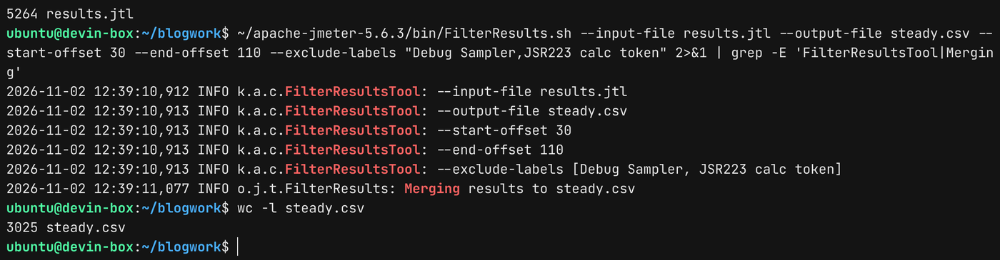
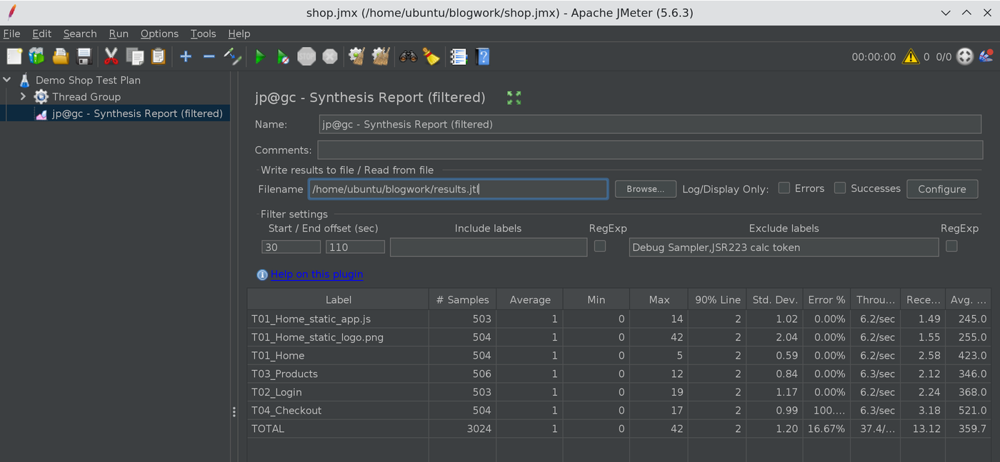

# JMeter Filter Results Tool: How to Remove Ramp-Up and Filter JTL Results

In this blog post, we will see how to use the JMeter Filter Results Tool to clean up a raw JTL file
before you report on it. We will cut the ramp-up and ramp-down phases, drop helper samplers like
Debug Sampler and JSR223 Sampler, keep only the transactions you care about, and do all of it from
the command line so it fits into a CI pipeline.

Every JTL I collect is a little dirty. The first 30 seconds are threads warming up, the last few
seconds are threads shutting down, and somewhere in the middle there are Debug Samplers and
token-generation scripts that are not real user requests. If you feed that file straight into the
HTML dashboard, your averages, throughput, and error percentage all describe a test that nobody
actually wanted to measure.

Everything below was verified on JMeter 5.6.3 with Filter Results Tool 2.3 (Java 17), using a real
120-second test I ran on my VM for this post.

## 1. What is the JMeter Filter Results Tool?

The Filter Results Tool is a jp@gc plugin from jmeter-plugins.org (plugin ID `jpgc-filterresults`,
tool class `kg.apc.cmdtools.FilterResultsTool`). It is a small command-line utility that reads an
existing JTL or CSV results file, applies filters, and writes a new results file. It does not run a
test and it does not touch your original file.

It is also growing fast. The [Filter Results Tool page](/plugin/jpgc-filterresults/) on PerfAtlas
currently shows 5,947 downloads with a trending delta of +623. Part of that comes from the
[Synthesis Report](/plugin/jpgc-synthesis/) plugin, which declares `jpgc-filterresults` as a
dependency, so anybody installing Synthesis Report gets it too.

Here is what it can filter on, straight from the
[official Filter Results Tool docs](https://jmeter-plugins.org/wiki/FilterResultsTool/):

| Option                  | Value          | What it does                                     |
| :---------------------- | :------------- | :----------------------------------------------- |
| `--input-file`          | file name      | JTL or CSV results file to read                  |
| `--output-file`         | file name      | Filtered file to write                           |
| `--success-filter`      | `true`/`false` | `true` keeps only successful samples             |
| `--include-labels`      | labels list    | Keep only these labels                           |
| `--exclude-labels`      | labels list    | Drop these labels                                |
| `--include-label-regex` | `true`/`false` | Treat `--include-labels` as a regular expression |
| `--exclude-label-regex` | `true`/`false` | Treat `--exclude-labels` as a regular expression |
| `--start-offset`        | seconds        | Drop samples that started before this point      |
| `--end-offset`          | seconds        | Drop samples that started after this point       |
| `--save-as-xml`         | `true`/`false` | Write XML instead of CSV (CSV is the default)    |

## 2. Installing the Filter Results Tool

If you do not have the Plugins Manager yet, follow
[How to install JMeter Plugins Manager](/blog/how-to-install-jmeter-plugins-manger/) first. In the
GUI, search for "Filter Results Tool" under Available Plugins and apply the changes.

For servers and containers I prefer the command line:

```bash
cd apache-jmeter-5.6.3
bin/PluginsManagerCMD.sh install jpgc-filterresults
```

The plugin ships an installer class that drops two launcher scripts into `bin/`: `FilterResults.sh`
and `FilterResults.bat`. The shell script is a thin wrapper around cmdrunner:

```bash
java $JVM_ARGS -Djava.awt.headless=true -jar $(dirname $0)/../lib/cmdrunner-2.3.jar --tool FilterResults "$@"
```

Two useful things fall out of that one line. It runs headless, so it works fine on a CI agent with
no display. And it honours `JVM_ARGS`, which matters later when we talk about big files. If you bake
plugins into a Docker image, the same install command works, see
[PluginsManagerCMD in a Docker image](/blog/jmeter-plugin-install-automation-pluginsmanagercmd-docker/).

## 3. The demo test and the raw JTL

To make the numbers real, I built a small test plan against a local HTTP server:

- One Thread Group, 20 threads, 30-second ramp-up, 120-second duration
- HTTP samplers `T01_Home`, `T01_Home_static_app.js`, `T01_Home_static_logo.png`, `T02_Login`,
  `T03_Products`, and `T04_Checkout`
- `T04_Checkout` points to a page that does not exist, so it always fails with `404`
- A `Debug Sampler` and a `JSR223 calc token` sampler that generates a UUID, the kind of helper
  samplers almost every real script has
- A Uniform Random Timer with 300 ms constant delay and 200 ms random delay

I ran it in non-GUI mode with the default CSV result format:

```bash
jmeter -n -t shop.jmx -l results.jtl
```

The raw `results.jtl` had 5,263 samples (5,264 lines with the header) over about 119.5 seconds. Here
is the problem in one table:

| Metric                       | Raw JTL            | What it should be                 |
| :--------------------------- | :----------------- | :-------------------------------- |
| Total samples                | 5,263              | Only real requests                |
| Samples from helper samplers | 1,299 (24.7%)      | 0                                 |
| Overall error %              | 12.45%             | 16.52% of HTTP requests failed    |
| `T01_Home` throughput        | 5.58/sec           | Steady-state rate with 20 threads |
| `T01_Home` max response time | 17 ms (cold start) | Steady-state max                  |

The Debug Sampler and JSR223 Sampler never fail, so they quietly dilute the error rate from 16.52%
down to 12.45%. The ramp-up period, where fewer than 20 threads were active, drags throughput down.
And the very first request, served cold, owns the maximum response time. None of that describes the
system at steady state.

## 4. How to remove ramp-up with `--start-offset` and `--end-offset`

This is the main reason people install the JMeter Filter Results Tool. With a 30-second ramp-up and
a 120-second test, I want to keep the window from 30 to 110 seconds:

```bash
bin/FilterResults.sh \
  --input-file results.jtl \
  --output-file steady.csv \
  --start-offset 30 \
  --end-offset 110 \
  --exclude-labels "Debug Sampler,JSR223 calc token"
```



The tool logs every option it parsed, which is handy in CI logs. The output went from 5,264 lines
down to 3,025 lines (3,024 samples plus the header).

The part that trips people up is how the offsets are measured. I read `CorrectedResultCollector` in
the [jmeter-plugins source](https://github.com/undera/jmeter-plugins) to confirm it:

- Both offsets are in **seconds** and are measured from the start time of the **first sample** in
  the file, rounded to the second.
- `--end-offset` is **not** "seconds to cut from the end". It is an absolute point measured from the
  start. `--end-offset 110` means "keep samples that started up to 110 seconds into the test".
- The comparison uses each sample's start timestamp, not its end time.
- Only positive integers are accepted. `0`, an empty value, or a decimal like `30.5` silently means
  "no limit" for that side.

In my run the first sample started at `...740017` ms, so the first kept sample started 30 seconds
later at `...770011`, and the last kept sample started at `...850966`, just inside the 110-second
mark. If your test runs for one hour with a 5-minute ramp-up and a 1-minute ramp-down, the values
are `--start-offset 300 --end-offset 3540`, not `--end-offset 60`.

Here is what the steady-state file looks like compared to the raw one:

| Metric                       | Raw `results.jtl` | Filtered `steady.csv` |
| :--------------------------- | :---------------- | :-------------------- |
| Samples                      | 5,263             | 3,024                 |
| Duration covered             | 119.5 s           | 81.0 s                |
| Overall error %              | 12.45%            | 16.67%                |
| `T01_Home` throughput        | 5.58/sec          | 6.23/sec              |
| `T03_Products` throughput    | 5.50/sec          | 6.25/sec              |
| `T01_Home` max response time | 17 ms             | 5 ms                  |

Throughput per transaction went up by about 12%, because we are now only looking at the period where
all 20 threads were active. The error rate now reflects the actual HTTP requests. This is the number
you want in your report.

## 5. Filtering by label: exact lists vs regex

Without the regex flags, `--include-labels` and `--exclude-labels` take a **comma-separated list of
exact label names**. The match is case-sensitive and must cover the whole label.

There is one gotcha I hit straight away. Spaces after the comma are kept as part of the label:

```bash
# Wrong: " T02_Login" (with a leading space) never matches
bin/FilterResults.sh --input-file results.jtl --output-file wrong.csv \
  --include-labels "T01_Home, T02_Login"

# Right
bin/FilterResults.sh --input-file results.jtl --output-file pages.csv \
  --include-labels "T01_Home,T02_Login"
```

The "wrong" command produced a file with only the 667 `T01_Home` samples. No warning, no error. Also
note that a label which itself contains a comma cannot be matched with the list syntax, use the
regex mode for that.

When you turn on `--include-label-regex true` or `--exclude-label-regex true`, the value is used as
a single Java regular expression and the whole label must match it (it uses `String.matches`, so
`T01` alone will not match `T01_Home`, you need `T01.*`). Include and exclude can be combined. This
is how I keep only the page-level transactions and drop the embedded static resources:

```bash
bin/FilterResults.sh \
  --input-file results.jtl \
  --output-file pages.csv \
  --include-label-regex true --include-labels "T0[1-4]_.*" \
  --exclude-label-regex true --exclude-labels ".*_static_.*"
```

Result per label:

| Label          | Samples kept |
| :------------- | -----------: |
| `T01_Home`     |          667 |
| `T02_Login`    |          658 |
| `T03_Products` |          658 |
| `T04_Checkout` |          655 |

The Debug Sampler and JSR223 Sampler are gone because they do not match `T0[1-4]_.*`, and the two
`_static_` resources are gone because of the exclude regex. If you name your samplers with a
consistent prefix like `T01_`, `T02_`, this one pattern keeps working as the script grows.

## 6. Keeping only successful samples

`--success-filter true` drops every sample where `success` is `false`:

```bash
bin/FilterResults.sh --input-file results.jtl --output-file ok.csv --success-filter true
```

In my run this left 4,608 samples and `T04_Checkout` disappeared completely, since all 655 of its
samples were 404s.

Use this carefully. A response time report built only from successful samples is useful when fast
failures (like an immediate 500 or a connection refused) would otherwise pull the average down. But
never publish an error rate from a success-filtered file. It will always be 0%. I usually generate
two files: the steady-state file for throughput and error rate, and a success-only file for response
time percentiles.

## 7. Output format and generating an HTML report

By default the output is CSV with a header line, using the column set from your JMeter `saveservice`
properties. Add `--save-as-xml true` to write XML instead:

```bash
bin/FilterResults.sh --input-file results.jtl --output-file steady.xml \
  --start-offset 30 --end-offset 110 --save-as-xml true
```

Two things I observed in the output that are worth knowing:

- The `URL` column came out as `null` in the filtered CSV, and the XML samples had no URL attribute,
  even though the input JTL had URLs. If you need URLs downstream, keep the raw file.
- Nothing is aggregated. It is still one row per sample.

The filtered CSV is a normal JTL, so you can feed it straight into the JMeter HTML dashboard
generator. I ran this against `steady.csv` and got a complete report:

```bash
jmeter -g steady.csv -o report-steady
```

This is the simplest way to get a dashboard that covers only the steady-state window. You can do the
same with graphs from `JMeterPluginsCMD`, which I covered in the
[3 Basic Graphs plugin post](/blog/jmeter-basic-graphs-plugin-response-times-active-threads-tps/).

## 8. The same filters in the GUI: Synthesis Report (filtered)

If you prefer to look at results in the GUI first, the Synthesis Report plugin exposes the exact
same filter engine. Add it via Add, Listener, `jp@gc - Synthesis Report (filtered)`, fill in the
Filter settings panel, and then load the JTL in the Filename field. Fill the filters first, because
they are applied when the file is loaded.



With start offset `30`, end offset `110`, and the same two exclude labels, the TOTAL row shows 3,024
samples, the exact same count the command-line tool wrote to `steady.csv`. I find this a good way to
pick the right offsets interactively and then copy them into the CLI command for the pipeline.

## 9. Using the Filter Results Tool in CI/CD

A typical pipeline step looks like this:

```bash
#!/usr/bin/env bash
set -euo pipefail

RAMP_UP=300
DURATION=3600
RAMP_DOWN=60

jmeter -n -t plan.jmx -l raw.jtl

JVM_ARGS="-Xmx2g" bin/FilterResults.sh \
  --input-file raw.jtl \
  --output-file steady.csv \
  --start-offset "$RAMP_UP" \
  --end-offset "$((DURATION - RAMP_DOWN))" \
  --exclude-label-regex true --exclude-labels "(Debug|JSR223|Setup).*"

jmeter -g steady.csv -o report
```

A few practical notes from reading the source and running it:

- The tool keeps all matching samples in memory and writes them at the end. For a multi-gigabyte
  JTL, raise the heap with `JVM_ARGS` as shown above, or filter by label first to shrink the file.
- If no sample matches your filters, no output file is written. Add a check like
  `test -s steady.csv` so the next step fails with a clear message instead of a confusing one.
- Keep the raw JTL as a pipeline artifact. The filtered file is for reporting, the raw file is for
  investigating what happened during ramp-up.
- If you also stop runaway tests with the
  [AutoStop Listener](/blog/jmeter-autostop-listener-stop-tests-on-sla-breach/), remember the test
  may end earlier than planned, so a fixed `--end-offset` can be longer than the actual run. That is
  harmless, it simply keeps everything up to the last sample.
- For distributed tests, merge the per-generator files first (the
  [Merge Results](/plugin/jpgc-mergeresults/) plugin or a simple concatenation of CSVs with one
  header), then filter the merged file once so all generators use the same time window.

## 10. Filter Results Tool vs other ways to filter

| Approach                                  | Ramp-up trim | Label filter | Regex | Headless |
| :---------------------------------------- | :----------: | :----------: | :---: | :------: |
| Filter Results Tool (`FilterResults.sh`)  |     Yes      |     Yes      |  Yes  |   Yes    |
| Synthesis Report (filtered) listener      |     Yes      |     Yes      |  Yes  |    No    |
| HTML dashboard `jmeter.reportgenerator.*` |  Date-based  |  Regex only  |  Yes  |   Yes    |

The HTML report generator has its own filters, but they apply only to that report and use absolute
date and time values, which you have to calculate per run. The Filter Results Tool produces a
reusable file with relative offsets, which is easier to script and works for every downstream tool,
not just the dashboard.

## Conclusion

The JMeter Filter Results Tool is a small plugin that fixes a big reporting problem. Use
`--start-offset` and `--end-offset` to keep only the steady-state window, remembering that both are
measured from the first sample. Exclude helper samplers so they stop diluting your error rate, use
regex mode for prefix-based naming conventions, and never quote an error rate from a
success-filtered file. In my 120-second demo, those few flags turned a 5,263-sample JTL that
under-reported errors by four percentage points into a clean 3,024-sample file that matched the GUI
exactly.

You can find download trends, versions, and the install ID on the
[Filter Results Tool page](/plugin/jpgc-filterresults/) on PerfAtlas.

Happy Testing!
