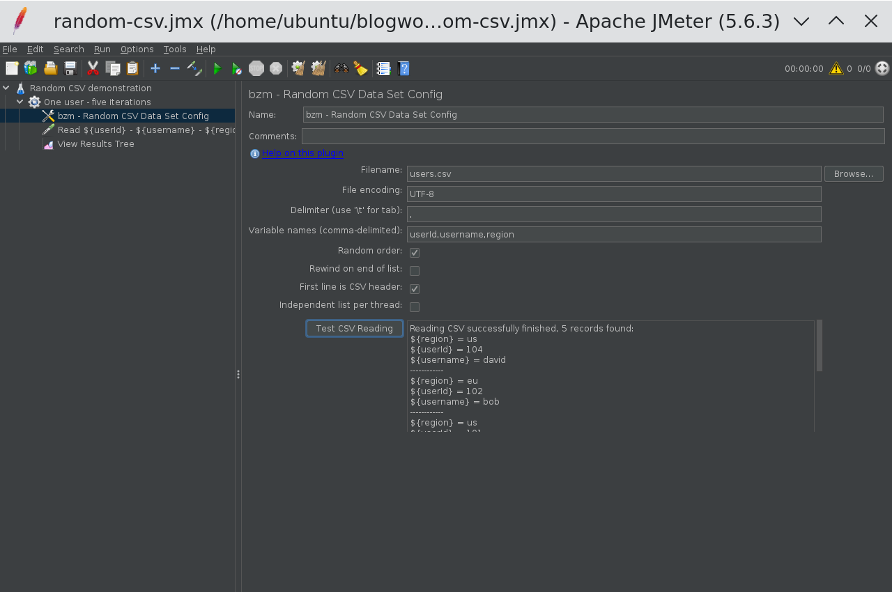
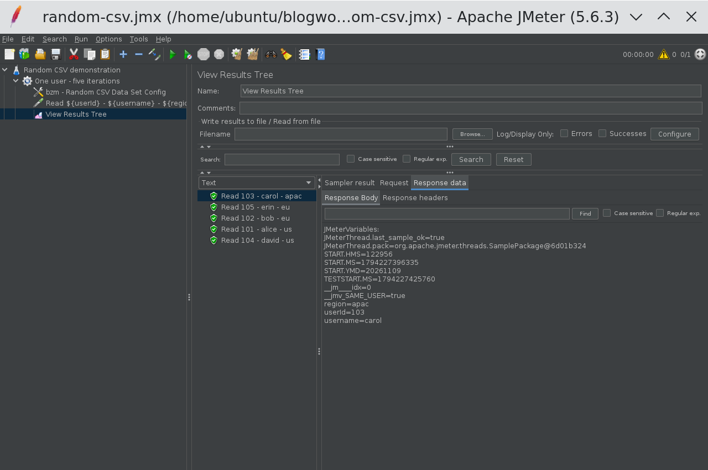

# JMeter Random CSV Data Set Config: How to Read Test Data in Random Order

In this blog post, we will see how the JMeter Random CSV Data Set Config plugin reads test data in
random order, and how to avoid accidentally sharing accounts between virtual users. I will use five
synthetic users, verify the variables in the JMeter GUI, and then run the same plan from the command
line. There is no application server involved, so we can separate data problems from API problems.

The plugin is BlazeMeter's [Random CSV Data Set](/plugin/bzm-random-csv/), identified as
`bzm-random-csv` in Plugins Manager. I tested version **0.8 with JMeter 5.6.3 and Java 17**. Its
useful distinction is not just randomness: you choose whether threads consume one shared list or
each thread has its own list. That choice matters much more than whether Alice appears before Bob.

## 1. When to use JMeter Random CSV Data Set Config

Suppose your CSV contains 10,000 product IDs sorted by category. Reading sequentially can make the
beginning of your test concentrate on one category, then move to another. A randomized traversal
mixes the input order without requiring you to shuffle the file before every run.

This is also useful for searches, customer lookups, and read-only account activity. It is not a
substitute for deciding your workload distribution. A file with 9,000 US accounts and 1,000 EU
accounts still has that composition after randomization. Random order does not make those regions
equally common.

I would keep the core CSV Data Set Config for straightforward sequential data feeding. I would add
this plugin when randomized traversal is a requirement, rather than adding scripting just to pick
random line numbers.

| Requirement                                      | Starting point                              |
| :----------------------------------------------- | :------------------------------------------ |
| Read rows sequentially with no extra plugin      | Core CSV Data Set Config                    |
| Consume CSV rows in random order                 | Random CSV Data Set Config                  |
| Let threads draw from one randomized pool        | Leave Independent list per thread unchecked |
| Give every thread a traversal of the entire file | Check Independent list per thread           |
| Reuse data after reaching the end                | Check Rewind on end of list                 |

The
[official README](https://github.com/Blazemeter/jmeter-bzm-plugins/blob/master/random-csv-data-set/RandomCSVDataSetConfig.md)
documents these options. Do not read its comparison with the core component as a promise that every
core setting exists here. This GUI has its own controls; for example, it does not expose the core
component's Sharing mode dropdown.

## 2. Install the plugin and prepare five rows

In JMeter, open **Options > Plugins Manager**, find **Random CSV Data Set**, install it, and
restart. If Plugins Manager is missing, follow the
[Plugins Manager installation guide](/blog/how-to-install-jmeter-plugins-manger/) first. Use the
same plugin version on every load generator, not just the machine where you edit the plan.

For my local verification I installed `jmeter-plugins-random-csv-data-set-0.8.jar` in
`JMETER_HOME/lib/ext` and its `jmeter-plugins-cmn-jmeter-0.7.jar` dependency in `JMETER_HOME/lib`,
then started JMeter. Plugins Manager normally handles dependency installation for you.

Create a directory containing your saved test plan and this `users.csv` file:

```csv
userId,username,region
101,alice,us
102,bob,eu
103,carol,apac
104,david,us
105,erin,eu
```

Use synthetic data, not production usernames or passwords. Keep the first trial tiny: five rows are
enough to spot a header being treated as data, a delimiter mismatch, or a repeated account. You can
inspect all five results before introducing thousands of users.

The README says relative filenames resolve against the active test plan. For distributed execution,
it specifically requires the file on the server hosts in the appropriate relative location for the
server process. Saving a file beside the controller's JMX does not copy it to remote engines.

## 3. Configure the data element and preview it

Add a normal **Thread Group** with **1 thread**, a **1-second ramp-up**, and **5 loops**. Under that
thread group, add **Config Element > bzm - Random CSV Data Set Config**. Save the plan as
`random-csv.jmx` beside `users.csv`.

Use these settings for the first run:

| Setting                     | Value                    | Reason                                       |
| :-------------------------- | :----------------------- | :------------------------------------------- |
| Filename                    | `users.csv`              | File beside the saved test plan              |
| File encoding               | `UTF-8`                  | Matches the input file                       |
| Delimiter                   | `,`                      | Splits these three columns                   |
| Variable names              | `userId,username,region` | Explicit destination variables               |
| Random order                | Checked                  | Random traversal rather than file order      |
| Rewind on end of list       | Unchecked                | Do not recycle rows                          |
| First line is CSV header    | Checked                  | Skip the header with explicit variable names |
| Independent list per thread | Unchecked                | One shared list                              |

Click **Test CSV Reading**. The preview should report five records and show variable mappings. It
shows at most 20 records, so it is a parsing smoke test, not proof that a large file is completely
valid.



There are two valid header approaches. With explicit **Variable names**, the **First line is CSV
header** checkbox tells the plugin to skip the file's first row. With **Variable names left empty**,
the plugin reads variable names from the header instead; the README says the checkbox is used only
when Variable names is not empty. Do not leave an arbitrary data row at the top and expect JMeter to
invent useful variable names.

The delimiter splits the file's columns. The variable-name list remains comma-delimited even if the
file itself uses another delimiter. For a semicolon-separated file, change Delimiter to `;`, but
keep the names as `userId,username,region`.

## 4. Verify the values without sending HTTP requests

Under the same Thread Group, add **Sampler > Debug Sampler**, and set **JMeter variables** to
`true`. Leave JMeter properties and system properties disabled so the response is easy to inspect.
Set the sampler's name to:

```text
Read ${userId} - ${username} - ${region}
```

Add **Listener > View Results Tree**, then start the test. Select a result and open **Response
data**. The body should contain matching values such as `userId=103`, `username=carol`, and
`region=apac`. All three columns come from the same selected row; the plugin is not independently
randomizing each column.



My GUI run produced IDs `103, 105, 102, 101, 104`. That sequence differs from the command-line run
below, which is expected. The important checks are five distinct IDs, matching fields, no header
record, and no unresolved `${username}` in the labels.

The configuration advances on iteration boundaries, not once per HTTP request. If you put three HTTP
samplers in the same ordinary Thread Group iteration, you can use the selected account across those
three requests. Do not calculate required CSV rows by counting total HTTP samples alone.

Once data feeding is correct, replace the Debug Sampler with your real requests and use variables in
their paths, parameters, or bodies. If you also need a mock response to test extractors, the
[Dummy Sampler guide](/blog/jmeter-dummy-sampler-mock-api-responses-debug-test-plans/) covers that
next step. Remove debugging listeners from actual load runs.

## 5. Choose shared or independent lists deliberately

With **Independent list per thread unchecked**, threads consume a common list. With Random order
enabled and rewind disabled, rows are consumed without replacement within that list. This is not the
same as making a fresh random choice from all five rows on every iteration.

For example, two threads running two iterations each need four row assignments. With a shared
five-row file and no rewind, that leaves one unused row. Which thread receives which row depends on
execution order; do not assume thread 1 receives the first two entries in some predictable shuffle.

With **Independent list per thread checked**, each thread traverses its own list. Two threads can
therefore both use account `101`, even before either thread exhausts its list. That can be perfectly
reasonable for read-only product searches. It can be wrong for login tests where a second session
invalidates the first, or for workflows that spend a single-use coupon.

| Five-row file, two threads                                          | Shared list                    | Independent lists |
| :------------------------------------------------------------------ | :----------------------------- | :---------------- |
| Available assignments before exhaustion, no rewind                  | 5 total                        | 5 per thread      |
| Can different threads receive the same row before a full traversal? | Not from that shared traversal | Yes               |
| Does this ensure uniqueness across remote engines?                  | No                             | No                |

Each remote engine is a separate process with its own file and plugin state. If three engines all
read the same 10,000 accounts, a local shared list does not create a global 30,000-account
allocator. Partition the accounts into separate files if cross-engine uniqueness is required.

Also separate row uniqueness from business uniqueness. Two CSV rows containing the same username are
still two different rows. A randomized traversal will not deduplicate them for you.

## 6. Understand rewind and end-of-file behavior

**Rewind on end of list** lets consumption continue after the list is exhausted. It is appropriate
for reusable search terms, but repeated rows become possible after a traversal. Five rows cannot
provide 500 unique account assignments, regardless of the random-order setting.

With rewind disabled, the plugin stops a thread when it attempts to read beyond the available
records. The
[configuration source](https://github.com/Blazemeter/jmeter-bzm-plugins/blob/master/random-csv-data-set/src/main/java/com/blazemeter/jmeter/RandomCSVDataSetConfig.java)
throws `JMeterStopThreadException` with the message `All records in the CSV file have been passed.`
Do not expect a core CSV-style `<EOF>` value or an extra Stop thread checkbox in this plugin.

That distinction can explain an unexpectedly short test: your duration might allow ten minutes, but
your non-rewinding data pool might only support the first minute of iterations. Check the JMeter log
and size the file against data-consuming iterations, not just your planned duration.

For an empty file or a header-only file, I would fail data preparation before starting load. There
are no usable rows to allocate. Do not rely on rewind to turn an empty data pool into valid input.
Likewise, test missing files and incorrect paths in a small local run before distributing a plan.

## 7. Run the same plan from the command line

From the directory containing the saved JMX and CSV, I ran:

```bash
$JMETER_HOME/bin/jmeter -n -t random-csv.jmx -l results.jtl -j jmeter.log
```

Use a new results filename for each verification run. My actual summary was:

```text
summary =      5 in 00:00:00 =   64.9/s Avg:     0 Min:     0 Max:     1 Err:     0 (0.00%)
```

The `label` column in that run's JTL contained:

```text
Read 103 - carol - apac
Read 104 - david - us
Read 102 - bob - eu
Read 105 - erin - eu
Read 101 - alice - us
```

Those are real Debug Sampler results, not application response times. The summary's request rate
does not measure your API's throughput. Here it only confirms the five data iterations completed
without sampler errors, while the labels establish that the variables were populated correctly.

If you maintain JMX in source control, these are the plugin properties corresponding to the tested
configuration. This is a config-element fragment, not a complete runnable test plan:

```xml
<com.blazemeter.jmeter.RandomCSVDataSetConfig
    guiclass="com.blazemeter.jmeter.RandomCSVDataSetConfigGui"
    testclass="com.blazemeter.jmeter.RandomCSVDataSetConfig"
    testname="bzm - Random CSV Data Set Config">
  <stringProp name="filename">users.csv</stringProp>
  <stringProp name="fileEncoding">UTF-8</stringProp>
  <stringProp name="delimiter">,</stringProp>
  <stringProp name="variableNames">userId,username,region</stringProp>
  <boolProp name="randomOrder">true</boolProp>
  <boolProp name="rewindOnTheEndOfList">false</boolProp>
  <boolProp name="ignoreFirstLine">true</boolProp>
  <boolProp name="independentListPerThread">false</boolProp>
</com.blazemeter.jmeter.RandomCSVDataSetConfig>
```

## 8. Check startup cost before scaling the data file

The README warns about startup delay and memory consumption with large files. The
[CSV reader source](https://github.com/Blazemeter/jmeter-bzm-plugins/blob/master/random-csv-data-set/src/main/java/com/blazemeter/csv/RandomCSVReader.java)
scans the file and builds row offsets. Random access is not a reason to assume negligible startup
work or unlimited file size.

I would first verify five rows, then test the intended file size on one load generator while
watching startup time and heap usage. Only then would I replicate the setup across engines. A
successful preview of 20 records says nothing about whether your generator has enough memory for the
full dataset under load.

## 9. Conclusion

Use Random CSV Data Set Config when you need randomized traversal of a CSV, not just because a test
uses data. Start with a shared list and rewind disabled when rows must not repeat within one
engine's traversal. Choose independent lists only when cross-thread reuse is acceptable. My main
takeaway: verify the row allocation rules with five synthetic records before letting thousands of
virtual users consume the file.
