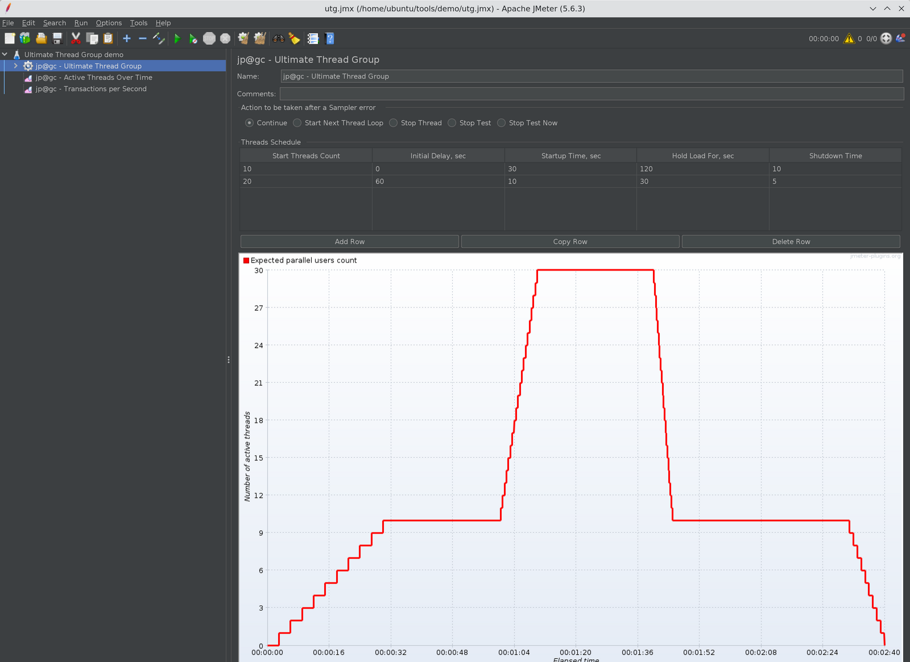
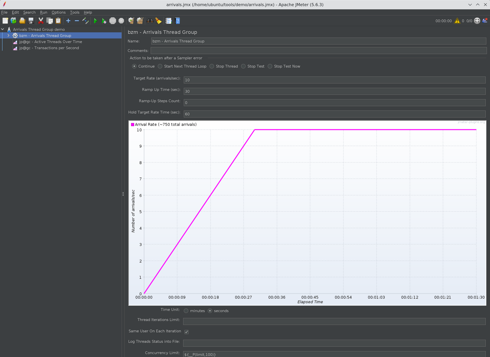
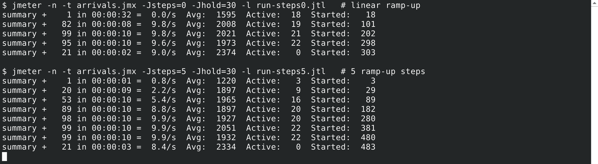
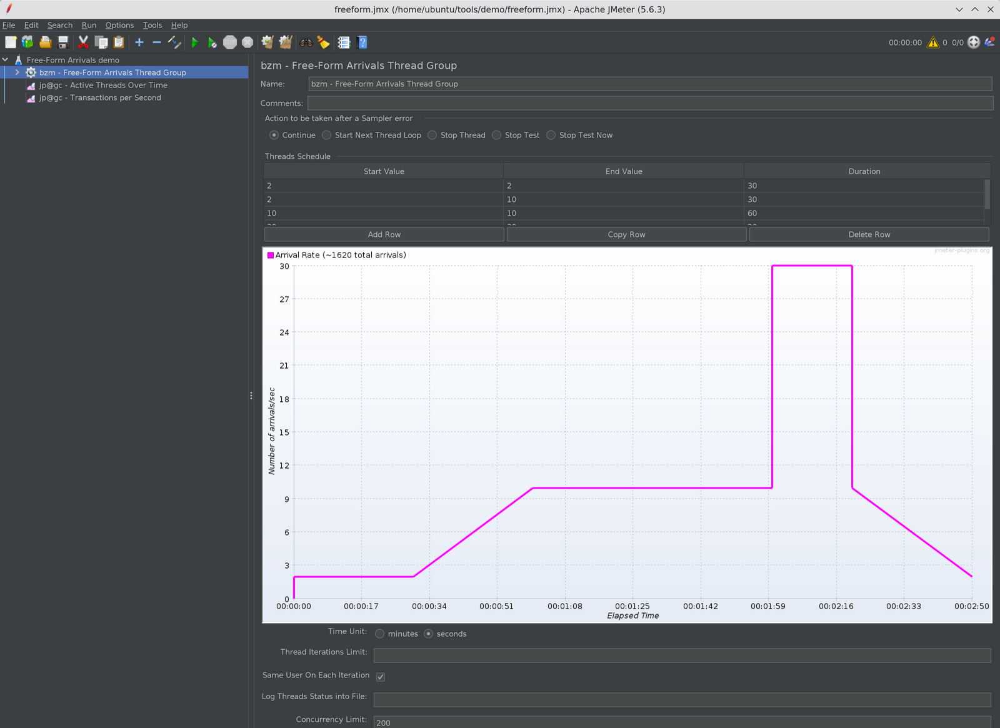

# JMeter Ultimate Thread Group vs Arrivals Thread Group: Which One to Use

In this blog post, we will see the JMeter Ultimate Thread Group vs Arrivals Thread Group debate in
practice: how each one generates load, how the Free-Form Arrivals Thread Group fits in, which
settings trip people up, and how to pick the right one for your test. All three ship in the same
[Custom Thread Groups](/plugin/jpgc-casutg/) plugin (`jpgc-casutg`), which is one of the most
downloaded and fastest-growing plugins in the PerfAtlas directory.

I ran every example below on Apache JMeter 5.6.3 with Custom Thread Groups 3.1.1.

## 1. One Plugin, Two Load Models

The Custom Thread Groups plugin adds five thread groups to JMeter: Stepping Thread Group, Ultimate
Thread Group, Concurrency Thread Group, Arrivals Thread Group, and Free-Form Arrivals Thread Group.
I already compared the Concurrency Thread Group with the Throughput Shaping Timer in
[JMeter Throughput Shaping Timer vs Concurrency Thread Group](/blog/jmeter-throughput-shaping-timer-vs-concurrency-thread-group/).
This post focuses on the other two families, which represent two different load models.

| Question                  | Ultimate Thread Group              | Arrivals / Free-Form Arrivals            |
| ------------------------- | ---------------------------------- | ---------------------------------------- |
| What do you configure?    | Number of threads (virtual users)  | Arrival rate (iteration starts per unit) |
| Load model                | Closed: fixed users loop           | Open: new work arrives on a schedule     |
| What varies with latency? | Throughput drops when server slows | Concurrency grows when server slows      |
| Shape definition          | Rows of spawn records              | Ramp/hold fields, or free-form rows      |
| Safety valve              | Thread count is the cap            | `Concurrency Limit` field                |
| CLI override built in     | `threads_schedule` property        | Use `${__P()}` in fields                 |

The key definition comes from the
[official Arrivals Thread Group docs](https://jmeter-plugins.org/wiki/ArrivalsThreadGroup/): an
"arrival" means a thread iteration start. If all existing threads are busy in the middle of an
iteration when the next arrival is due, the thread group creates a new thread.

That single sentence is the whole difference. Ultimate Thread Group says "keep 20 users busy".
Arrivals Thread Group says "start 10 iterations every second, no matter how long each one takes".

## 2. Installing Custom Thread Groups

If you use the Plugins Manager, search for **Custom Thread Groups** and install it. If you have not
set up the Plugins Manager yet, follow
[How to Install JMeter Plugins Manager](/blog/how-to-install-jmeter-plugins-manger/).

For CI images and Docker containers, install it from the command line:

```bash
./bin/PluginsManagerCMD.sh install jpgc-casutg
```

I covered the full headless workflow in
[JMeter Plugin Install Automation with PluginsManagerCMD and Docker](/blog/jmeter-plugin-install-automation-pluginsmanagercmd-docker/).
After a restart, you will find the new elements under **Add > Threads (Users)**.

## 3. How the Ultimate Thread Group Works

The [Ultimate Thread Group](https://jmeter-plugins.org/wiki/UltimateThreadGroup/) lets you add as
many schedule rows as you need. Each row has five columns:

| Column              | Meaning                                                  |
| ------------------- | -------------------------------------------------------- |
| Start Threads Count | Threads this row adds                                    |
| Initial Delay, sec  | Wait time from test start before this row begins ramping |
| Startup Time, sec   | Time to start all threads of this row                    |
| Hold Load For, sec  | How long the threads keep running after startup          |
| Shutdown Time       | Time to stop the threads of this row                     |

Rows are independent and additive. In my demo plan, I used two rows to model a steady baseline plus
a short spike:

| Row | Threads | Initial Delay | Startup | Hold | Shutdown |
| --- | ------- | ------------- | ------- | ---- | -------- |
| 1   | 10      | 0             | 30      | 120  | 10       |
| 2   | 20      | 60            | 10      | 30   | 5        |

Row 1 ramps to 10 threads over 30 seconds and holds until the 150-second mark. Row 2 starts at 60
seconds, adds 20 more threads in 10 seconds, and holds them for 30 seconds. Between roughly 70 and
100 seconds, the test runs 30 concurrent threads. The plugin draws this in its expected load preview
graph, which is the best part of this thread group.



_Ultimate Thread Group with a 10-thread baseline row and a 20-thread spike row. The preview graph
shows the expected number of active threads over time._

### Driving the schedule from the command line

The Ultimate Thread Group reads a JMeter property named `threads_schedule`. When it is set, the GUI
rows are ignored. The syntax is a list of spawn directives:

```text
spawn(threadsCount, initialDelay, startupTime, holdLoadFor, shutdownTime)
```

Here is the same two-row profile passed from the CLI:

```bash
jmeter -n -t utg.jmx \
  -J "threads_schedule=spawn(10,0s,30s,120s,10s) spawn(20,60s,10s,30s,5s)" \
  -l results.jtl
```

You can also put it in `user.properties`:

```properties
threads_schedule=spawn(10,0s,30s,120s,10s) spawn(20,60s,10s,30s,5s)
```

I verified this with a short `spawn(5,0s,5s,10s,2s)` run. The JMeter log confirms the override:

```text
INFO k.a.j.t.UltimateThreadGroup: GUI threads profile will be ignored
INFO k.a.j.t.UltimateThreadGroup: Setting threads profile from property threads_schedule: spawn(5,0s,5s,10s,2s)
INFO o.a.j.e.StandardJMeterEngine: Starting 5 threads for group jp@gc - Ultimate Thread Group.
```

This is very handy when the same JMX must run a smoke profile in a pull request pipeline and a full
peak profile at night.

## 4. How the Arrivals Thread Group Works

The Arrivals Thread Group has four load fields in the GUI:

- **Target Rate (arrivals/sec)**
- **Ramp Up Time (sec)**
- **Ramp-Up Steps Count**
- **Hold Target Rate Time (sec)**

Below them, there are additional fields: **Time Unit** (minutes or seconds), **Thread Iterations
Limit**, **Same User On Each Iteration**, **Log Threads Status into File**, and **Concurrency
Limit**.



_Arrivals Thread Group with a target of 10 arrivals per second, a 30-second ramp-up, 0 ramp-up
steps, a 60-second hold, the time unit set to seconds, and the Concurrency Limit read from a `limit`
property (default 100). The preview graph draws a linear ramp with about 750 total arrivals._

My demo plan used a Dummy Sampler with a random response time between 1000 and 3000 ms, so each
iteration takes about 2 seconds on average. With a target of 10 arrivals per second, Little's Law
gives the expected concurrency:

```text
concurrency = arrival rate x time per iteration
            = 10/s x 2 s
            = ~20 threads
```

That is exactly what happened. During the hold phase, the run sustained about 9.8 iterations per
second with 19 to 22 active threads. I never typed "20 threads" anywhere. The thread group worked it
out from the rate and the response time.

### Ramp-Up Steps Count: check the real ramp, not only the preview

When **Ramp-Up Steps Count** is greater than 0, the plugin splits the ramp into equal steps. For a
10/s target, a 30-second ramp, and 5 steps, the rate moves through 2, 4, 6, 8, and 10 arrivals per
second, with each step lasting 6 seconds.

When it is 0, the preview graph draws a smooth linear ramp, as you can see in the screenshot above.
My real runs with Custom Thread Groups 3.1.1 behaved differently. The JMeter log showed the thread
group starting at 11:41:49 and the first arrival thread starting at 11:42:20. In other words, no
iterations ran during the whole 30-second ramp-up, and then the load jumped straight to 10/s. In the
`ArrivalsThreadStarter` source, the linear-ramp formula derives the current rate from the number of
arrivals already scheduled, which is zero at the very start, so the rate stays at zero until the
ramp-up time has passed.

I ran the same plan twice from the CLI with a 30-second hold, once with 0 steps and once with 5
steps, and printed the summariser output side by side:



_Two CLI runs of the same Arrivals Thread Group plan. The 0-step run reports its first sample only
after 32 seconds. The 5-step run climbs through 2.2/s, 5.4/s, and 8.8/s before settling near the
10/s target. Both runs peak at 22 active threads._

| Run       | Iterations started | First arrival       | Rate during hold | Max active threads |
| --------- | ------------------ | ------------------- | ---------------- | ------------------ |
| Steps = 0 | 303                | After ~30 s ramp-up | ~9.8/s           | 22                 |
| Steps = 5 | 483                | Immediately         | ~9.9/s           | 22                 |

The numbers line up with the math. The stepped ramp schedules 6 x (2 + 4 + 6 + 8 + 10) = 180
arrivals, plus 30 x 10 = 300 in the hold, for about 480. The 0-step run only produced the hold
phase. So if you need a gradual ramp, set a steps count. Using the ramp-up seconds as the count, for
example 30 steps for a 30-second ramp, gives a 1-second staircase that is close to smooth. Either
way, add an Active Threads Over Time or Transactions per Second listener to a short trial run and
confirm the ramp you actually get.

To make values switchable from the command line, use the `__P` function in the fields:

```bash
jmeter -n -t arrivals.jmx -Jsteps=5 -Jhold=30 -Jlimit=100 -l run-steps5.jtl
```

with `${__P(steps,0)}`, `${__P(hold,60)}`, and `${__P(limit,100)}` in the corresponding fields.

## 5. The Concurrency Limit Is Not Optional

The official docs are blunt about this: a constant arrival rate means increasing concurrency, and
the **Concurrency Limit** field is the safety valve that keeps you from running out of memory.

Let us do the math. With 10 arrivals per second and a healthy 2-second iteration, you need about 20
threads. If the application slows down to 20 seconds per iteration, the same rate needs 200 threads.
At 60 seconds per iteration, it needs 600. Without a limit, JMeter keeps creating threads until the
load generator struggles, and then your results measure JMeter, not the application.

In the plugin source, when no idle pooled thread is available and the limit has been reached, the
thread group simply does not create a new thread for that arrival. So the achieved rate falls below
your target. That gap is useful information: it tells you the system under test can no longer keep
up with the requested rate at that concurrency.

I ran the same 10/s plan, with 0 ramp-up steps and a 60-second hold, using two different limits.
Because of the 0-step behavior above, all iterations in both runs came from the hold phase:

| Concurrency Limit | Iterations started | Peak active threads | Rate during hold |
| ----------------- | ------------------ | ------------------- | ---------------- |
| 100               | 600                | 24                  | ~9.7 to 10.0/s   |
| 15                | 444                | 15                  | ~6.4 to 7.3/s    |

With 15 threads and roughly 2 seconds per iteration, Little's Law caps throughput at 15 / 2 = 7.5
iterations per second, which is very close to the ceiling the limited run hit. The target was 10/s,
but the load generator was not allowed to add the threads needed to reach it.

My rule of thumb is to set the limit to 2 to 3 times the expected concurrency from Little's Law:

| Target rate | Expected iteration time | Expected threads | Concurrency Limit I use |
| ----------- | ----------------------- | ---------------- | ----------------------- |
| 10/s        | 2 s                     | 20               | 50                      |
| 50/s        | 1.5 s                   | 75               | 200                     |
| 200/s       | 0.5 s                   | 100              | 300                     |

## 6. Watch the Time Unit Default

This one catches almost everyone. In the plugin GUI, the **Time Unit** radio button defaults to
**minutes**. If you type 10 in Target Rate and leave the default, you get 10 arrivals per minute,
not 10 per second. Your test will look strangely idle.

Before every run, check the unit. In the JMX, the property looks like this:

```xml
<stringProp name="TargetLevel">10</stringProp>
<stringProp name="RampUp">30</stringProp>
<stringProp name="Steps">0</stringProp>
<stringProp name="Hold">60</stringProp>
<stringProp name="Unit">S</stringProp>
<stringProp name="ConcurrencyLimit">100</stringProp>
```

`Unit` set to `S` means seconds. If you see `M`, the rate is per minute. The ramp-up and hold
durations follow the same unit, so a hold of 60 with `M` means one hour.

## 7. Free-Form Arrivals Thread Group for Custom Shapes

The [Free-Form Arrivals Thread Group](https://jmeter-plugins.org/wiki/FreeFormArrivalsThreadGroup/)
uses the same arriving-users idea, but replaces the ramp and hold fields with a schedule table. Each
row has **Start Value**, **End Value**, and **Duration**. The rate moves linearly from the start
value to the end value across the row duration, so you can model plateaus, ramps, spikes, and
ramp-downs in one element.

Here is the schedule from my demo, with Time Unit set to seconds and a Concurrency Limit of 200:

| Row | Start Value | End Value | Duration (s) | What it models          |
| --- | ----------- | --------- | ------------ | ----------------------- |
| 1   | 2           | 2         | 30           | Quiet warm-up at 2/s    |
| 2   | 2           | 10        | 30           | Ramp to normal traffic  |
| 3   | 10          | 10        | 60           | Steady 10/s             |
| 4   | 30          | 30        | 20           | Flash spike at 30/s     |
| 5   | 10          | 2         | 30           | Ramp-down back to quiet |



_Free-Form Arrivals Thread Group with five schedule rows. The preview graph shows the target arrival
rate across the 170-second test._

Row 4 starts at 30 even though row 3 ended at 10. That is a jump, not a ramp, which is exactly what
a flash sale or a push notification looks like in production traffic. The whole schedule lasts 170
seconds.

## 8. JMeter Ultimate Thread Group vs Arrivals Thread Group: Which to Use

Here is how I decide, based on the question the test needs to answer:

| Scenario                                                        | My pick                       |
| --------------------------------------------------------------- | ----------------------------- |
| "Can 500 logged-in users work without errors?"                  | Ultimate Thread Group         |
| Session-heavy flows with login, think time, and logout per user | Ultimate Thread Group         |
| Licensed or connection-limited systems (fixed seats, pools)     | Ultimate Thread Group         |
| "Can checkout handle 50 orders per second?"                     | Arrivals Thread Group         |
| Public APIs and web traffic where users do not wait for others  | Arrivals Thread Group         |
| Finding the rate where latency breaks the SLA                   | Arrivals Thread Group         |
| Replaying a day's traffic shape or modeling a flash spike       | Free-Form Arrivals            |
| Same JMX for smoke and peak runs, switched from CI              | Ultimate (`threads_schedule`) |

The deeper reason is the load model. With the Ultimate Thread Group, when the server slows down,
each thread waits longer, so throughput drops. The test quietly becomes gentler exactly when the
system is in trouble. That is fine when you really have a fixed population of users, such as
internal staff or a call center.

With the Arrivals Thread Group, new work keeps arriving at the target rate while the server is slow,
just like real internet traffic. That exposes queueing, thread pool exhaustion, and timeouts much
earlier. The trade-off is that you must budget threads with the Concurrency Limit.

A few practical notes for both:

- Keep think time in mind. With Arrivals, a Constant Timer inside the iteration adds to the time per
  iteration, so it increases concurrency rather than lowering throughput.
- Run real tests in non-GUI mode and watch active threads next to throughput. Streaming both into a
  dashboard, as in
  [Real-Time JMeter Metrics with Prometheus and Grafana](/blog/real-time-jmeter-metrics-with-prometheus-and-grafana-using-the-backend-listener/),
  makes the concurrency growth obvious.

## 9. Conclusion

The Ultimate Thread Group and the Arrivals Thread Group are not competitors. They answer different
questions. Ultimate Thread Group controls how many users exist, and the thread schedule is easy to
override from the CLI with `threads_schedule`. Arrivals and Free-Form Arrivals control how often
work starts, and JMeter adds threads to keep that rate.

My takeaway: if your requirement is written in users, use the Ultimate Thread Group. If it is
written in requests, orders, or transactions per second, use the Arrivals Thread Group, set the Time
Unit to seconds, use a ramp-up steps count, and always set a Concurrency Limit based on Little's
Law. Reach for Free-Form Arrivals when the traffic shape itself is the thing you want to test.
