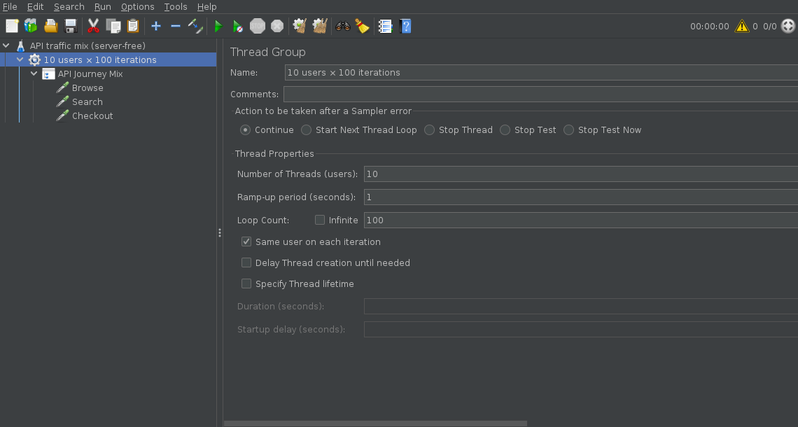
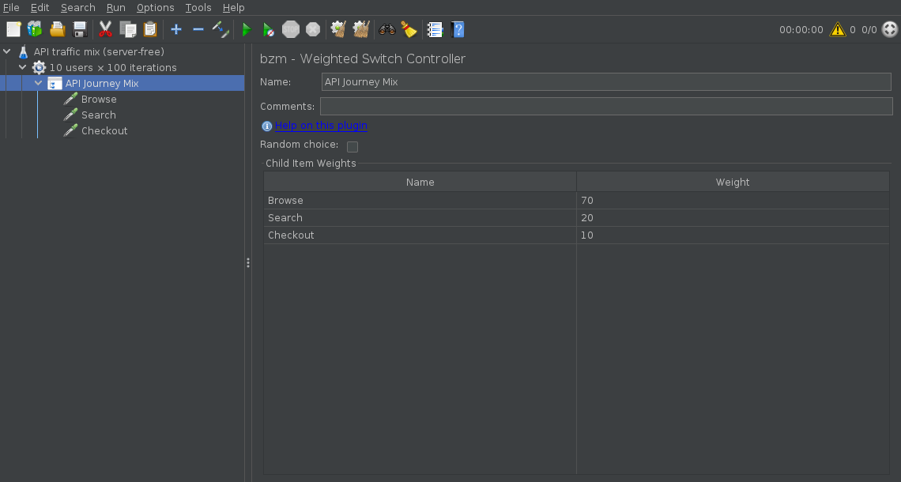

In this blog post, we will see how to use the JMeter Weighted Switch Controller to model a 70/20/10
API traffic mix and verify the result from a JTL file. I will use three Dummy Samplers so you can
run the same test on your laptop without an API server, credentials, or test data.

When I see browse, search, and checkout samplers stacked under the same Thread Group, my first
question is whether every virtual user really checks out on every iteration. If not, the test might
hit the right total requests per second and still put the wrong load on the checkout service. I like
to prove the traffic split on its own before adding HTTP requests, timers, and assertions. That way,
if the numbers change later, I have a small test that tells me where to start looking.

## 1. What the JMeter Weighted Switch Controller controls

The [Weighted Switch Controller](/plugin/jpgc-wsc/) chooses one direct child when a thread reaches
it. That child can be a sampler or a controller with multiple steps. The
[official plugin documentation](https://github.com/Blazemeter/jmeter-bzm-plugins/blob/master/wsc/WeightedSwitchController.md)
describes the weights as relative: each enabled child's share is its weight divided by the sum of
the enabled weights. So `7`, `2`, and `1` describe the same mix as `70`, `20`, and `10`. I use the
latter because it's easier to compare with the percentages from a traffic report.

| Branch   | Weight | Share of branch selections | Expected out of 1,000 |
| -------- | -----: | -------------------------: | --------------------: |
| Browse   |     70 |                        70% |                   700 |
| Search   |     20 |                        20% |                   200 |
| Checkout |     10 |                        10% |                   100 |

The controller does not set RPS or limit concurrent users. It answers a different question: when the
test plan reaches this decision, which branch should it take? Use the Thread Group to set up the
users, or see my
[Throughput Shaping Timer vs Concurrency Thread Group guide](/blog/jmeter-throughput-shaping-timer-vs-concurrency-thread-group/)
if you need to control a request rate or a concurrency schedule. To check a percentage for one
isolated action rather than pick one of several branches, see JMeter's built-in
[Throughput Controller](https://jmeter.apache.org/usermanual/component_reference.html#Throughput_Controller).
Despite its name, that controller controls execution frequency, not RPS either.

## 2. Install the plugins and set up the server-free plan

I tested with JMeter 5.6.3, Java 17, Weighted Switch Controller 0.7, and Dummy Sampler 0.4. In
**Options > Plugins Manager > Available Plugins**, find **Weighted Switch Controller** and **Dummy
Sampler**, select both, and apply the changes and restart. If you don't see Plugins Manager in the
menu, start with the
[JMeter Plugins Manager installation guide](/blog/how-to-install-jmeter-plugins-manger/).

1. Add a standard **Thread Group**. Set **Number of Threads (users)** to `10`, **Ramp-up period
   (seconds)** to `1`, and **Loop Count** to `100`. Leave **Infinite** unchecked.
2. Under the Thread Group, choose **Add > Logic Controller > bzm - Weighted Switch Controller**.
3. Under the Weighted Switch Controller, add three **jp@gc - Dummy Sampler** elements. Name them
   `Browse`, `Search`, and `Checkout`. Make all three direct children of the controller, not
   siblings below it. Set each sampler to succeed with response code `200`, and turn off **Simulate
   Response Time** so the run doesn't wait for a simulated server.
4. Select the Weighted Switch Controller again. In **Child Item Weights**, enter `70`, `20`, and
   `10` for the three rows. Press Enter after editing the last cell so the value is committed. Leave
   **Random choice** unchecked for the first run and save as `traffic-mix.jmx`.





Ten users running 100 iterations produce 1,000 visits to the switch in this plan. Each visit runs
one sampler, so the JTL should contain 1,000 sample rows. A [Dummy Sampler](/plugin/jpgc-dummy/)
returns a synthetic result rather than making a network request. In a separate test, you can add
response bodies or errors to check how the rest of your plan responds, without changing the mix.

If you review your JMX in version control, look for `IsRandomChoice` and `Weights` inside
`com.blazemeter.jmeter.control.WeightedSwitchController`. Here is the first row from the JMX saved
by the GUI. JMeter generates the numeric `name` attributes from hashes. Read the values in order:
child name, weight, and enabled state.

```xml
<boolProp name="IsRandomChoice">false</boolProp>
<collectionProp name="Weights">
  <collectionProp name="452480606">
    <stringProp name="1998230186">Browse</stringProp>
    <stringProp name="1753">70</stringProp>
    <stringProp name="3569038">true</stringProp>
  </collectionProp>
</collectionProp>
```

The GUI matches weights by child name when it rebuilds the table. During a run, though, the
controller uses the saved row order to select children by position. I swapped Browse and Search in
the JMX without moving their weight rows. The next CLI run selected Search 700 times and Browse 200
times, reversing their original counts. After reordering or renaming a branch, reopen the controller
panel, check the weights, and save the plan again before running it. Use unique names; renamed and
newly added children get the default weight when the table is rebuilt.

## 3. Run from the CLI and count the JTL rows

Run the plan without the GUI. The command assumes `jmeter` is on your `PATH`; otherwise, use the
launcher under your installation's `bin` directory. Pick a fresh results filename for each run so
you don't count rows from a previous run. The `-J` flags explicitly request a CSV file with column
headers, sampler labels, and success flags.

```bash
jmeter -n -t traffic-mix.jmx -l traffic-mix.jtl \
  -Jjmeter.save.saveservice.output_format=csv \
  -Jjmeter.save.saveservice.print_field_names=true \
  -Jjmeter.save.saveservice.label=true \
  -Jjmeter.save.saveservice.successful=true
```

Use a CSV parser to count labels. This script also counts unsuccessful samples separately. I don't
filter them out of the distribution: a failed request still represents a branch selection in this
one-sampler-per-branch plan. Dropping failures would hide part of the traffic you actually sent.

```bash
python3 - traffic-mix.jtl <<'PY'
import csv
import sys
from collections import Counter

with open(sys.argv[1], newline='', encoding='utf-8') as results:
    rows = list(csv.DictReader(results))

counts = Counter(row['label'] for row in rows)
for label in ('Browse', 'Search', 'Checkout'):
    print(f'{label:8} {counts[label]:4} {counts[label] / len(rows):6.1%}')
print(f'Total: {len(rows)}; failed: {sum(row["success"] != "true" for row in rows)}')
PY
```

My run returned these counts:

```text
Browse    700  70.0%
Search    200  20.0%
Checkout  100  10.0%
Total: 1000; failed: 0
```

That verifies the mix, not the performance of an API. All samples were generated locally without
waiting for a response. The CLI summary's throughput and elapsed times therefore don't tell us
anything about a real service. For this smoke test, I look at the sample count, the branch counts,
and the error count and leave the timing columns alone.

## 4. What changes when you enable Random choice?

With **Random choice** off, the controller tracks selections per thread and favors the branch that's
furthest behind its target share. With the box checked, each selection is a weighted random draw
instead. The
[upstream implementation](https://github.com/Blazemeter/jmeter-bzm-plugins/blob/master/wsc/src/main/java/com/blazemeter/jmeter/control/WeightedSwitchController.java)
shows both paths. To compare, enable the option, save as `traffic-mix-random.jmx`, and run the same
command and counter with `traffic-mix-random.jtl` as the new results file.

| Branch   | Random choice off | Random choice on, one run |
| -------- | ----------------: | ------------------------: |
| Browse   |       700 (70.0%) |               721 (72.1%) |
| Search   |       200 (20.0%) |               197 (19.7%) |
| Checkout |       100 (10.0%) |                 82 (8.2%) |
| Total    |             1,000 |                     1,000 |

Neither run had errors. In the random run Checkout was 18 selections below the target count. That
doesn't mean the weight was ignored. The percentage describes the chance of choosing the branch on
each draw, not a quota for the run. I keep the box off when I want to compare the same mix from run
to run. I check it when I want a less predictable sequence and can tolerate variation in the
observed split. If a pipeline checks a random run, use a tolerance appropriate to the number of
draws rather than expecting the exact 700/200/100 counts.

The non-random run hit the target exactly because each thread had 100 selections and the target
counts fit those 100 selections. Don't assume you'll get the same precision if a short test stops
threads after only a few iterations. Ten threads making one selection each are not the same as one
thread making ten selections: each thread has its own counter. I use enough iterations per thread to
check the distribution before changing the plan to stop by duration.

## 5. Move from a sampler mix to a journey mix

Once the smoke test passes, replace each Dummy Sampler with the real HTTP sampler or a **Simple
Controller** that groups the requests for that journey. Keep one direct child per journey. If
Checkout includes a cart update, shipping quote, and payment request, put all three under the same
Checkout controller. Otherwise each request becomes a separate choice instead of one step in a
selected journey. Give every request a distinct label so the JTL tells you which step ran.

As an example, suppose Browse and Search still have one request each, but Checkout now has three. If
all steps run and you log just the HTTP samples, then the same 700/200/100 branch selections produce
this request mix:

| Branch   | Journey executions | HTTP requests per journey | Total HTTP requests |
| -------- | -----------------: | ------------------------: | ------------------: |
| Browse   |                700 |                         1 |                 700 |
| Search   |                200 |                         1 |                 200 |
| Checkout |                100 |                         3 |                 300 |

Checkout is still 10% of journeys, but now accounts for 300 out of 1,200 requests, or 25% of the
HTTP traffic. If the source data says 10% of _requests_ hit checkout endpoints, don't copy that
figure directly into the journey weights. First decide whether the source is counting requests,
completed transactions, or sessions. Then pick a consistent measure for validation, such as a
distinct first request label per journey for starts. Count individual HTTP samples separately when
reconciling endpoint traffic.

## 6. Troubleshoot a split that looks wrong

- **All three calls run every time.** Check the tree indentation. If the samplers are siblings of
  the switch, the Thread Group can run them independently. The weight table should list exactly the
  three children you want the switch to choose from.
- **A branch was renamed or disabled.** Check the table after edits. Disabled children don't count
  toward the sum. Disabling Checkout leaves Browse and Search at `70:20`, or about 77.8% and 22.2%,
  not 70% and 20% with a missing 10%.
- **The sample total doesn't match your loop count.** Check that the switch is reached once per
  iteration and that no early stop reduces the number of completed loops. In a full plan, samplers
  outside the switch and multi-step journeys also make the JTL row count differ from the selection
  count.
- **Two reports disagree.** Check the denominator first. An endpoint report might include setup
  calls or retries, while your journey report counts only branch starts. Compare like with like
  before adjusting weights.

## Conclusion

Use the JMeter Weighted Switch Controller to decide **what users do**, not **how fast they do it**.
I start with a short Dummy Sampler run, check the branch counts in the JTL, and only then swap in
real HTTP requests. When a branch grows into a multi-step journey, track journey share and request
share separately. That distinction matters more than getting the weights to add up to 100.
